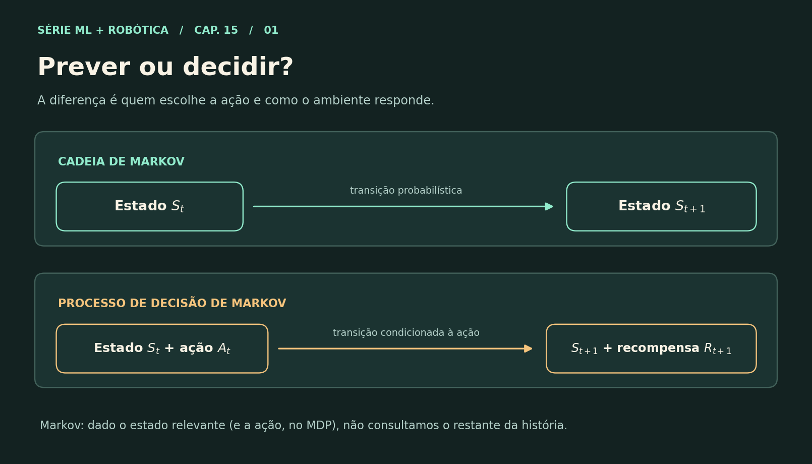

# 15. Cadeias de Markov e processos de decisão de Markov

O laboratório compara previsão de transições com decisão por recompensa. Os exemplos são didáticos: clima de dois estados, memória de ordem 2 representada por pares e um MDP de navegação resolvido por iteração síncrona de valores.



## Execute em CPU

O laboratório e os testes usam apenas a biblioteca padrão do Python:

```bash
python3 lab_markov.py
python3 -m unittest -v
```

Use `--trials 0` para pular a amostragem, ou escolha `--trials` e `--seed` para repetir sua própria simulação.

- `lab_markov.py`: probabilidades exatas e simuladas, matriz sobre estados compostos, valores, políticas e cadeias induzidas.
- `test_lab_markov.py`: seis testes de comportamento, incluindo a mudança da ação ótima com o fator de desconto.
- `resultados.txt`: saída da execução de referência.
- `diagramas.py`: recria as quatro imagens em `figuras/`. Só esse script precisa de Matplotlib (`python3 -m pip install matplotlib`).

No exemplo do robô, o ganho esperado do atalho é 1. Com desconto de 0,9, o desvio vale 6,2; com desconto 0, vale −1. Estados finais são absorventes na cadeia induzida e não geram recompensa futura.
