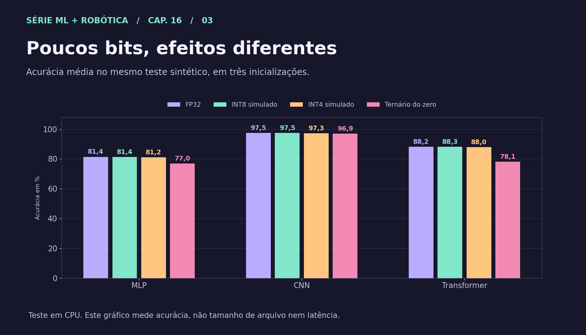

# 16. Quantização em PyTorch: do MLP ao Transformer

O laboratório compara MLP, CNN e um Transformer de imagens sobre a mesma tarefa sintética de quatro classes. Ele usa pesos FP32, INT8 e INT4 simulados após o treino e treinamento ternário com STE. Não baixa dados nem checkpoints.



[Artigo no LinkedIn](https://www.linkedin.com/pulse/quantiza%25C3%25A7%25C3%25A3o-na-pr%25C3%25A1tica-do-mlp-aos-llms-com-pesos-em-santos-daltro-0iuqe/) · [Post de divulgação](https://www.linkedin.com/feed/update/urn:li:activity:7531735862972276737/)

## Reproduza em CPU

```bash
python3 -m venv .venv
source .venv/bin/activate
python -m pip install torch==2.9.1
python lab_quantizacao.py --out resultados-reproduzidos.json
python -m unittest -v
```

No Windows, use `.venv\Scripts\Activate.ps1` para ativar o ambiente. Consulte o [seletor oficial do PyTorch](https://pytorch.org/get-started/locally/) se precisar de outra build para seu sistema.

- `lab_quantizacao.py`: as 36 combinações (três sementes por arquitetura e modo), com acurácia de teste, erro L2 relativo e histogramas.
- `test_lab_quantizacao.py`: quatro testes para intervalos, valores zero, gradiente STE, formatos e contagem de símbolos.
- `resultados.json`: execução de referência em CPU com PyTorch 2.9.1.
- `int8_cpu.py`: demonstração separada de Linear dinâmica com peso real `torch.qint8`, pela API legada `torch.ao.quantization`. Execute com `python int8_cpu.py` em uma build que ofereça um backend compatível. `resultados-int8-cpu.txt` registra o tamanho do `state_dict` e o erro naquela execução, não a latência.
- `diagramas.py`: recria as quatro imagens em `figuras/` com Matplotlib instalado.

No laboratório principal, as ativações e a aritmética continuam em ponto flutuante. INT8 e INT4 simulados usam o mesmo checkpoint FP32; o ternário treina pesos-mestres separados e usa os três símbolos no forward. A fração de zeros não implica aceleração ou armazenamento compacto. Os resultados sintéticos não substituem um benchmark na tarefa e no hardware de destino.
