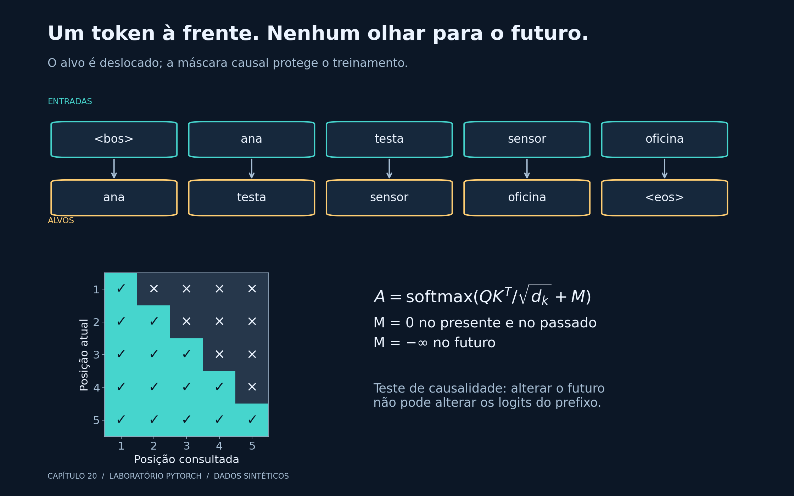
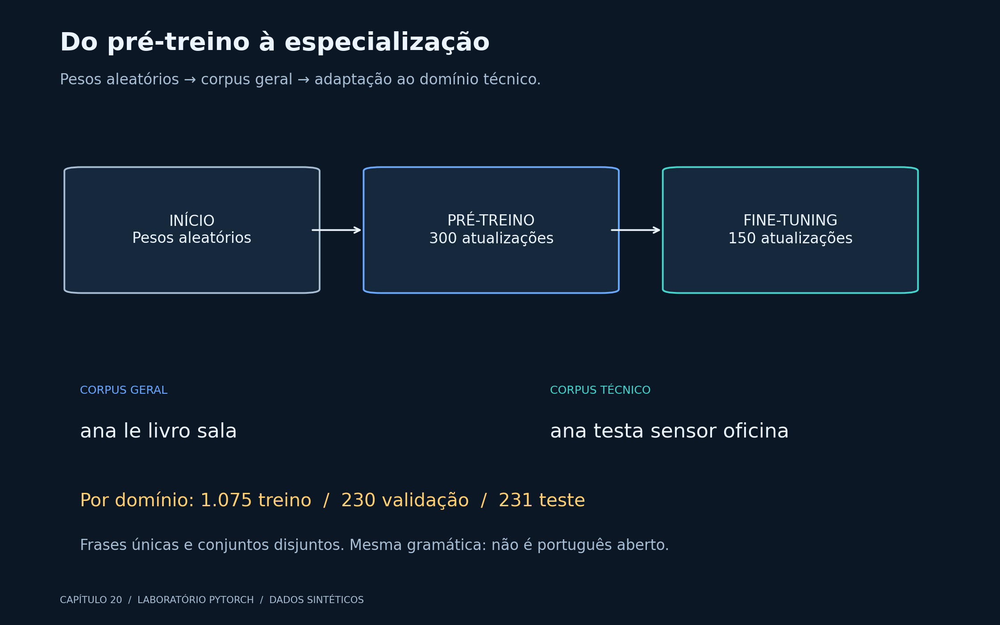
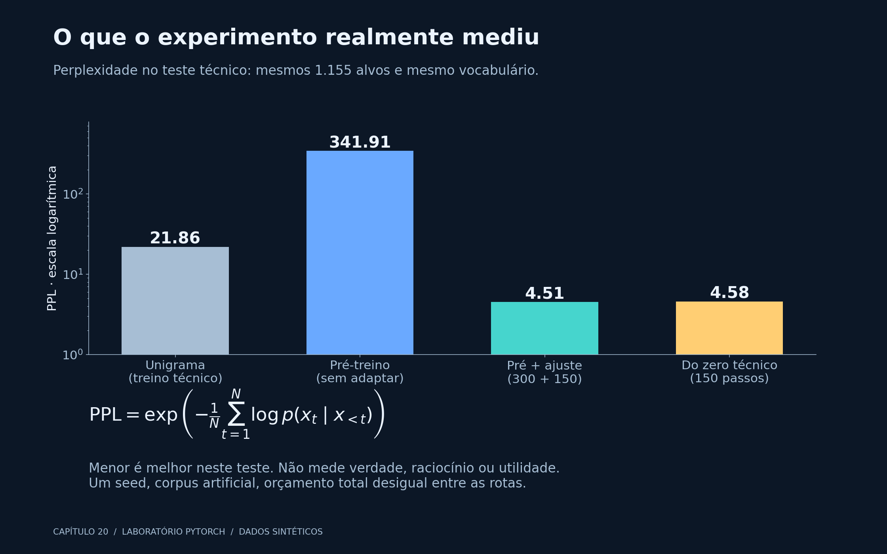

# Capítulo 20: treinando um mini Transformer causal do zero com PyTorch

Uma rede pode gerar uma frase sem que exista uma resposta pronta escondida no código. Mas como ela aprende? Neste capítulo, vamos sair do desenho da arquitetura e executar o ciclo completo: dados, tokens, atenção causal, perda, gradientes, avaliação e geração.

O laboratório usa **um modelo pequeno inicializado aleatoriamente**, treinado em CPU. Não baixa pesos de um modelo pronto e não chama uma API. Os textos são sintéticos e produzidos pelo próprio código. Isso permite auditar exatamente o que entrou no treinamento e no teste.

A proposta não é construir um ChatGPT em miniatura. É enxergar, sem infraestrutura cara, os mecanismos de um modelo autorregressivo e os erros que invalidam sua avaliação.

## 1. O problema: prever o próximo token

A distribuição de uma sequência pode ser fatorada como:

$$
p_\theta(x_1,\ldots,x_T)=\prod_{t=1}^{T}p_\theta(x_t\mid x_{<t}).
$$

Na prática, entregamos um prefixo e pedimos uma distribuição sobre o próximo token. Os alvos vêm do próprio texto, não de um anotador humano: é aprendizado autossupervisionado.

Nosso tokenizador separa palavras por espaços e adiciona dois símbolos: `<bos>` marca o começo, `<eos>` marca o fim. Uma frase vira:

```text
Sequência: <bos> ana testa sensor oficina <eos>
Entrada:   <bos> ana testa sensor oficina
Alvo:      ana   testa sensor oficina <eos>
```

A função que transforma um lote em pares de entrada e alvo é curta:

```python
def xy(batch):
    return batch[:, :-1], batch[:, 1:]
```

Cada posição aprende uma previsão. O primeiro vetor prevê `ana`; o segundo, `testa`; o último prevê o encerramento da frase. Não estamos pedindo que o modelo simplesmente copie o token que recebeu.



**Leitura da figura:** cada seta liga uma entrada ao próximo token que ela deve prever. Na matriz, a posição atual pode consultar a diagonal e as posições anteriores, nunca as futuras.

## 2. Dados pequenos, mas avaliação honesta

Criamos dois universos com a mesma estrutura:

```text
Geral:   ana le livro sala
Técnico: ana testa sensor oficina
```

Cada domínio combina 12 nomes, 4 verbos, 8 objetos e 4 locais: **1.536 frases diferentes**. Os conjuntos são embaralhados com seeds fixas e separados por frase inteira:

| Conjunto | Frases por domínio | Uso |
|---|---:|---|
| Treino | 1.075 | Atualizar os pesos |
| Validação | 230 | Escolher o checkpoint |
| Teste | 231 | Medir o resultado final |

Não criamos janelas sobre um texto inteiro para depois distribuí-las aleatoriamente entre treino e teste. Essa prática pode colocar quase o mesmo trecho nos dois lados. Aqui cada documento é independente e as frases completas são disjuntas, inclusive entre os dois domínios.

Ainda assim, **as mesmas palavras e a mesma gramática aparecem nos conjuntos**. O teste mede novas combinações dentro desta distribuição artificial, não compreensão geral de português. Essa limitação faz parte do experimento, não é um detalhe de rodapé.

O vocabulário de 46 tokens é declarado a partir da especificação do gerador, antes de dividir os exemplos. Não foi descoberto lendo o teste. Num projeto com texto real, treine o tokenizador apenas nos dados autorizados de treinamento e defina como tratar palavras ou subpalavras desconhecidas.

Todas as frases têm seis tokens com os delimitadores, portanto cinco alvos. Não precisamos de padding. Com comprimentos variáveis, será necessário mascarar padding na atenção e ignorá-lo na perda e na contagem de tokens.

## 3. O que existe dentro do modelo

A arquitetura é deliberadamente compacta:

- Embedding de tokens com dimensão 48.
- Embedding de posição aprendido, contexto máximo de 8 posições.
- Dois blocos com quatro cabeças de atenção cada.
- Cada cabeça trabalha com dimensão 12.
- LayerNorm antes da atenção e do MLP, conexões residuais e ativação GELU.
- MLP com dimensão interna 192.
- LayerNorm final e projeção para 46 logits.

São **61.486 parâmetros treináveis**, sem dropout e sem compartilhamento de pesos entre embedding e projeção final. A ausência de dropout simplifica este experimento; não é uma recomendação universal.

É um modelo causal do tipo decoder-only: não existe cross-attention para consultar a saída de um encoder separado. A arquitetura original de Transformer de Vaswani e colaboradores era encoder-decoder. Estamos usando seus componentes centrais em uma organização autorregressiva. [Attention Is All You Need](https://arxiv.org/abs/1706.03762).

O coração da atenção é:

$$
A=\operatorname{softmax}\left(\frac{QK^\top}{\sqrt{d_k}}+M\right),\qquad H=AV.
$$

Aqui, $M_{ij}=0$ quando $j\le i$, e $M_{ij}=-\infty$ quando $j>i$. Depois do softmax, as posições proibidas recebem probabilidade zero.

Trecho central do bloco, implementado explicitamente no laboratório:

```python
q, k, v = self.qkv(self.ln1(x)).chunk(3, dim=-1)
q, k, v = [
    z.view(b, t, self.h, d // self.h).transpose(1, 2)
    for z in [q, k, v]
]
scores = q @ k.transpose(-2, -1) / math.sqrt(d // self.h)
future = torch.ones(t, t, dtype=torch.bool, device=x.device).triu(1)
scores = scores.masked_fill(future, float('-inf'))
attention = scores.softmax(dim=-1) @ v
x = x + self.out(attention.transpose(1, 2).contiguous().view(b, t, d))
x = x + self.ff(self.ln2(x))
```

**Cuidado com as APIs:** neste `masked_fill`, `True` significa posição a bloquear. Não copie essa convenção cegamente para outra função. No argumento booleano `attn_mask` de `scaled_dot_product_attention`, `True` indica participação na atenção. A alternativa otimizada com `is_causal=True` deve ser usada conforme sua própria documentação. [PyTorch: scaled dot-product attention](https://docs.pytorch.org/docs/2.8/generated/torch.nn.functional.scaled_dot_product_attention.html).

Por que a máscara importa tanto? Durante o treino, todos os tokens da frase estão disponíveis na entrada. Sem bloqueio causal, o modelo poderia olhar a posição seguinte e encontrar justamente a resposta que deveria prever.

## 4. Um passo real de treinamento

Um lote tem forma `[B, T]`. O modelo retorna `[B, T, V]`: para cada posição, um logit por token do vocabulário. Para calcular a perda, reunimos as dimensões de lote e tempo:

```python
x, y = xy(batch)
logits = model(x)
loss = F.cross_entropy(
    logits.reshape(-1, len(VOCAB)),
    y.reshape(-1),
)
optimizer.zero_grad(set_to_none=True)
loss.backward()
nn.utils.clip_grad_norm_(model.parameters(), 1.0)
optimizer.step()
```

`cross_entropy` recebe **logits**, não probabilidades já normalizadas. Internamente, incorpora a transformação necessária para calcular a log-verossimilhança negativa. Aplicar softmax antes é um erro frequente. [PyTorch: cross_entropy](https://docs.pytorch.org/docs/2.8/generated/torch.nn.functional.cross_entropy.html).

A perda média é:

$$
\mathcal L=-\frac{1}{N}\sum_{t=1}^{N}\log p_\theta(x_t\mid x_{<t}).
$$

Usamos AdamW, lotes de 64 frases amostradas com reposição, `weight_decay=0.01` e clipping de norma 1. Não há scheduler. “300 passos” significa 300 atualizações, não 300 épocas completas.

A cada 25 passos, medimos a validação sem gradientes e guardamos uma cópia do melhor `state_dict`. Os melhores checkpoints foram os passos 150 do pré-treino, 125 do ajuste e 150 do treino técnico do zero. O custo reportado inclui também os passos posteriores avaliados. O teste não escolhe checkpoint, taxa de aprendizado nem número de passos. Os hiperparâmetros deste exercício foram fixados antes da execução reportada.

## 5. Pré-treino, fine-tuning e uma comparação necessária

Primeiro treinamos do zero no domínio geral por 300 passos, com taxa de aprendizado `3e-3`. Em seguida, continuamos dos melhores pesos gerais no corpus técnico por 150 passos, com taxa `1e-3` e um novo otimizador.

Essa segunda fase é **adaptação de domínio com o mesmo objetivo de próximo token**. Não é ajuste por instruções, RLHF ou alinhamento de preferências. “Fine-tuning” descreve a continuação a partir de pesos existentes; o formato dos dados e o objetivo continuam importando.



Também treinamos uma segunda rede aleatória diretamente no domínio técnico pelos mesmos 150 passos e taxa `1e-3`. Assim não confundimos aprender os dados técnicos com provar que o pré-treino foi indispensável.

A comparação ainda tem uma diferença importante: a rota pré-treino + adaptação custa **450 atualizações totais**, enquanto a rota técnica do zero custa 150. Ela compara o mesmo orçamento da fase técnica, não o mesmo custo total.

## 6. Perplexidade: uma métrica com condições

Definimos a perplexidade como:

$$
\operatorname{PPL}=\exp(\mathcal L).
$$

Intuitivamente, ela expressa o grau de surpresa do modelo diante dos tokens corretos. Uma perplexidade menor indica melhor probabilidade atribuída aos alvos **daquele conjunto**, não mais verdade ou inteligência.

Na avaliação somamos a perda de todos os tokens e só depois dividimos pelo número total de alvos. Não tiramos uma média simples das médias de lotes desiguais.

Os números abaixo vêm de uma execução real em CPU com Python 3.9.6, PyTorch 2.8.0 e seed `20261126`. Todos usam **o mesmo teste técnico de 231 frases, 1.155 tokens-alvo e o mesmo vocabulário/tokenizador**:

| Modelo | NLL por token | Perplexidade |
|---|---:|---:|
| Unigrama técnico com suavização +1 | 3,0846 | 21,8578 |
| Pré-treinado geral, sem adaptar | 5,8345 | 341,9085 |
| Pré-treinado + fine-tuning técnico | 1,5063 | 4,5101 |
| Do zero no técnico, 150 passos | 1,5209 | 4,5762 |

O baseline unigrama estima frequências apenas nos alvos do treino técnico, adiciona 1 a cada contagem e ignora o contexto. Ele estabelece uma referência simples, não o melhor baseline possível: um modelo por posição ou um n-grama seriam próximos controles úteis.



O pré-treinado geral começa muito ruim no domínio técnico: ele aprendeu a esperar palavras gerais e atribui baixa probabilidade às técnicas. A adaptação corrige isso. Já a pequena diferença entre 4,5101 e 4,5762 **não prova vantagem robusta de transferência**: temos um seed, dados artificiais e orçamentos totais diferentes.

Outro resultado ensina uma lição importante: no teste geral, a perplexidade foi de **4,4483 antes da adaptação para 64,0781 depois**. É um exemplo mensurável de perda de desempenho no domínio anterior após especialização. Misturar dados gerais, reduzir a taxa ou usar adaptações restritas são hipóteses para investigar, não soluções já demonstradas por esta execução.

## 7. Treinar e gerar são processos diferentes

No treinamento, prevemos todas as posições de uma frase em paralelo usando os prefixos reais, uma prática chamada teacher forcing. Na geração, o token recém-escolhido passa a fazer parte do contexto da próxima previsão. Erros podem se acumular.

Duas estratégias simples:

```python
# Greedy: escolhe o token de maior logit.
next_id = logits.argmax().item()

# Amostragem: sorteia conforme a distribuição ajustada.
probs = (logits / temperature).softmax(dim=-1)
next_id = torch.multinomial(probs, 1, generator=rng).item()
```

A temperatura deve ser positiva. Valores menores concentram a distribuição; valores maiores a espalham. Dividir logits por uma temperatura positiva não muda o argmax, portanto temperatura sozinha não altera greedy. A função `multinomial` permite explicitar o gerador para controlar a repetibilidade da amostragem. [PyTorch: multinomial](https://docs.pytorch.org/docs/2.8/generated/torch.multinomial.html).

Com o prefixo `ana testa`, a execução produziu:

```text
Greedy: <bos> ana testa sensor bancada <eos>
T=0.7:  <bos> ana testa circuito laboratorio <eos>
T=1.2:  <bos> ana testa circuito laboratorio <eos>
```

Os dois sorteios com a mesma seed coincidiram. Isso é possível: temperatura muda probabilidades, mas não obriga uma saída diferente em cada execução. Não selecionamos exemplos mais bonitos para esconder o resultado.

A função encerra ao encontrar `<eos>` ou o limite de novos tokens. O código inclui recorte da janela de contexto, sem KV cache; para frases longas, reiniciar posições aprendidas seria outra limitação a estudar. Aqui os exemplos cabem na janela.

## 8. Executando o laboratório

Na pasta `20-transformer-treino`, com Python compatível e acesso ao PyPI:

```bash
python3 -m venv .venv
source .venv/bin/activate
python -m pip install -r requirements.txt
python -m unittest -v
python train.py
python figures.py
```

No Windows, ative o ambiente com `.venv\Scripts\activate`. Os arquivos principais são `train.py`, `test_train.py`, `requirements.txt` e `figures.py`. A execução grava `results.json`, `splits.json` e `model.pt`; as figuras são regeneradas a partir das métricas.

Os cinco testes passaram: deslocamento dos alvos, disjunção das frases, invariância causal do prefixo, formas/gradientes finitos e repetibilidade da amostragem com rejeição de temperatura inválida. O teste de causalidade altera tokens futuros e exige que os logits anteriores permaneçam iguais.

O trecho medido de treinamento e avaliação levou aproximadamente **6,12 segundos** nesta máquina, excluindo instalação e importação inicial. Não é promessa de tempo em qualquer CPU. Seeds e algoritmos determinísticos ajudam, mas resultados bit a bit podem variar entre versões e plataformas.

## 9. Antes de crescer o modelo

Para transformar este exercício em um projeto sério, troque o corpus artificial por dados com licença e proveniência claras, faça deduplicação e separação por fonte/documento, treine ou escolha um tokenizador adequado e monitore métricas de tarefas reais. Inclua controles mais fortes que unigramas e repita experimentos com várias seeds.

Só então avalie contexto maior, batches variáveis com padding, otimizações de atenção, mixed precision, checkpoints retomáveis, custo de GPU e KV cache. Escalar um pipeline com vazamento só produz uma métrica enganosa mais cara.

A principal conquista deste capítulo não é uma frase convincente. É poder responder: **o que o modelo viu, o que ele não podia ver e em quais dados o resultado foi medido?**
