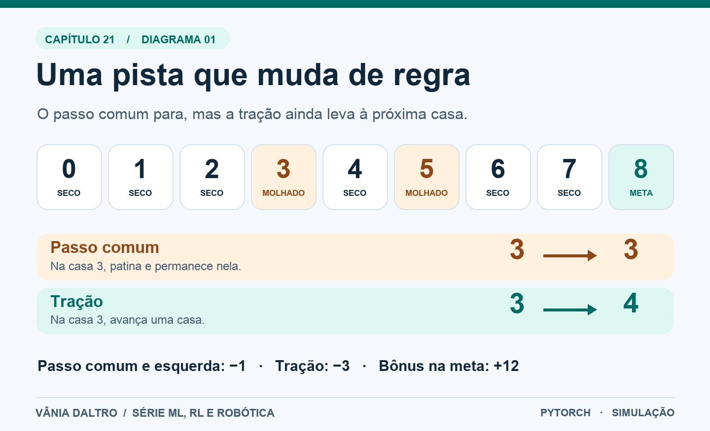
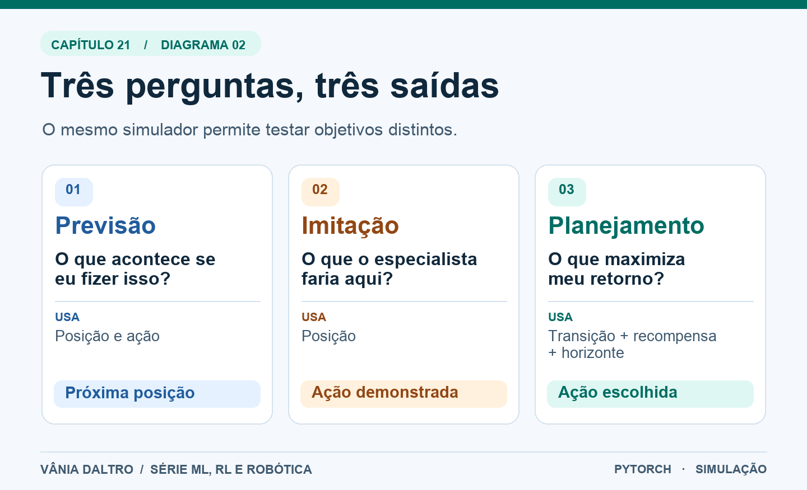
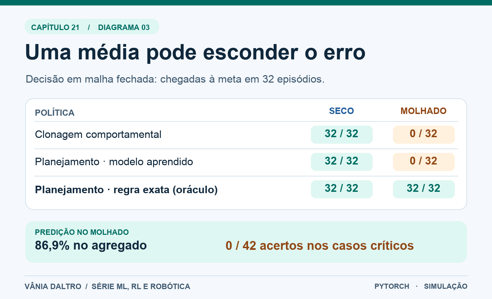

# Da previsão à decisão: um robô de brinquedo em PyTorch

**Capítulo 21 | Predição, imitação e decisão por recompensa, no mesmo simulador**

O robô chega à casa 3 e tenta avançar. Patina, fica onde está, tenta de novo. O curioso: o modelo que descreve o mundo ainda acerta **86,9%** das previsões de um passo no piso molhado. Nos casos em que o passo comum parte de uma das casas molhadas, acerta **0 de 42**. E a política que depende desse modelo não chega ao destino em nenhum dos 32 episódios.

Neste tutorial, montei um simulador simples para medir três coisas separadamente: se a rede prevê a próxima observação, se consegue imitar um demonstrador e se uma política alcança o objetivo quando as regras do ambiente mudam.

## 1. Nove casas, três ações e um piso que muda

O estado observado é só a posição, de 0 a 8. A casa 8 encerra o episódio e dá bônus de +12 na chegada. Há até 12 decisões. Andar para a esquerda ou dar um passo comum para a direita custa 1 ponto. Usar tração avança uma casa para a direita e custa 3. Não se pode sair pela esquerda da casa 0.

No piso seco, passo comum e tração têm o mesmo efeito para a direita. No piso molhado, o passo comum **não desloca** se partir da casa 3 ou da casa 5. A tração continua funcionando. A regra é fixa em cada cenário; a rede não recebe um indicador do piso.



## 2. O preditor responde: o que acontece se eu fizer isso?

Gerei 80 episódios de exploração no piso seco. Em cada passo, uma ação aleatória fornece a tupla `(posição, ação, próxima posição)`. Resultaram 644 transições, cobrindo os 24 pares válidos de posição não terminal e ação no treino. A MLP recebe posição e ação em vetores one-hot e produz nove logits, um por próxima posição possível. Treino com [entropia cruzada do PyTorch](https://docs.pytorch.org/docs/2.9/generated/torch.nn.CrossEntropyLoss.html) e uso `argmax` no teste.

```python
train_s, train_a, train_y = zip(*explore(2101, 80, DRY))
predictor = fit(inputs(train_s, train_a), train_y, GOAL + 1)
```

Ou seja: o alvo de treino é a próxima posição observada. O preditor pode descrever o efeito de uma ação proposta, mas recebe essa ação como entrada. Ele não recebeu o objetivo nem escolhe como chegar lá.

## 3. A clonagem responde: o que o demonstrador faria?

Em 40 episódios demonstrados, sempre no piso seco, o demonstrador escolhe o passo comum para a direita. São 264 pares `(posição, ação do demonstrador)`. Treino outra MLP, agora com posição como entrada e três logits para decidir uma ação.

```python
demo_s, demo_a = zip(*demonstrations(2102, 40))
clone = fit(inputs(demo_s), demo_a, len(ACTIONS))
```

É **clonagem comportamental**: supervisionado sobre ações. O agente pode atuar sozinho após o treino, mas não aprendeu a escolher por recompensa. Como nunca viu a tração como ação demonstrada, repetir o passo funciona no piso seco e falha nas casas molhadas. A literatura de imitação explica outro risco geral: as escolhas da própria política podem gerar observações que o demonstrador raramente visitaria. Aqui a posição 3 já foi vista; **o que mudou foi o resultado da ação**, não apenas a frequência das posições. [Ross, Gordon e Bagnell, 2011](https://proceedings.mlr.press/v15/ross11a.html).

## 4. O planejador responde: o que rende mais pontos até o fim?

Para decidir por recompensa, calculo uma tabela por programação dinâmica. Para cada posição e quantidade de passos restantes, avalio as três ações e somo recompensa imediata ao melhor retorno restante. Escrevendo `T` para a transição, `h` para o horizonte restante e `r` para a recompensa:

$$
V_h(s) = \max_a \left[r(s,a,T(s,a)) + V_{h-1}(T(s,a))\right]
$$

A base é `V_0(s)=0`, e `V_h(8)=0` após encerrar. O trecho central:

```python
for a in ACTIONS:
    next_s = dynamics(s, a)
    scores.append(reward(s, a, next_s) + values[next_s])
best = max(ACTIONS, key=scores.__getitem__)
```

Em uma versão, `dynamics` vem do **preditor treinado no seco**, com seu destino mais provável para cada par. Em outra, forneço a **regra exata** do piso avaliado. A segunda é uma referência privilegiada, ou oráculo: ela recebe informação que a primeira não recebe. O algoritmo de planejamento, a recompensa e os episódios de avaliação são os mesmos. A troca isola o efeito do modelo usado na decisão.

Na casa 3 molhada, faltando pelo menos cinco passos, usar tração em 3 e 5 e passos comuns nas outras três casas dá `12 − 2×3 − 3×1 = +3`. Se houver tempo para patinar uma vez antes de seguir essa rota, o retorno cai a `+2`; se só restarem cinco passos, patinar torna a chegada impossível.



**Onde entra RL?** O oráculo faz planejamento com dinâmica fornecida, sem atualizar a política a partir de experiência. A variante aprendida, no sentido amplo, é um exemplo *offline* baseado em modelo: estima a dinâmica por supervisão em dados fixos e depois planeja com recompensa especificada. Não há coleta adaptativa, treino da política por retorno, Q-learning nem atualização no teste. Um próximo passo de RL seria aprender de transições com recompensas, por exemplo estimando `Q(s,a)` diretamente ou corrigindo o modelo com novas interações e replanejando. Planejar é uma etapa comum em RL baseado em modelo, mas rodar Bellman com a regra pronta não demonstra aprendizagem por interação. [Sutton e Barto, capítulos 4 e 8](https://mitpress.ublish.com/book/reinforcement-learning-an-introduction-2).

## 5. Medindo a previsão e a decisão em testes separados

Para previsão, usei 32 novos episódios de exploração por piso, com semente de teste distinta. Os episódios foram gerados separadamente dos de treino, não por divisão aleatória de suas linhas. Como o mundo é pequeno e determinístico, os mesmos pares posição/ação podem aparecer no treino e no teste seco. Isso testa a reprodução das regras conhecidas, não a generalização para casas inéditas.

Para decisão, executei três políticas em malha fechada, nos mesmos 32 inícios sorteados de 0 a 3 para ambos os pisos. A própria ação determina a próxima observação. Os inícios repetem posições; 32 execuções não significam 32 mapas. A métrica principal é chegada em até 12 passos, mais o retorno total médio.

| Medida | Seco | Molhado |
|---|---:|---:|
| Preditor: próxima posição correta | 300/300 (100%) | 279/321 (86,9%) |
| Preditor: passo comum partindo de 3 ou 5 | 26/26 | 0/42 |
| Clonagem: chegou à meta | 32/32 | 0/32 |
| Planejador com modelo aprendido: chegou | 32/32 | 0/32 |
| Planejador com regra exata: chegou | 32/32 | 32/32 |

Retornos médios de clonagem, planejador aprendido e oráculo: **+5,8125** para todos no seco; **−12**, **−12** e **+1,8125** no molhado, respectivamente. No exemplo que começa em 0 e usa o oráculo no piso molhado, o robô chega com retorno 0: bônus 12 menos seis passos comuns e duas ações de tração.



O experimento separa uma **mudança da dinâmica** `P(s' | s, a)` de uma simples queda de desempenho médio. A previsão agregada esconde os erros que mais afetam a rota. Em um problema real, eu mediria por cenário e ação crítica antes de confiar em uma média única. E testaria o controlador em malha fechada, sem dar ao candidato o mapa correto se esse mapa não estará disponível no uso.

## 6. Rode localmente

No diretório do capítulo, com Python 3.10 ou posterior. Reprodução verificada com PyTorch 2.9.1 na CPU:

```bash
python -m venv .venv
source .venv/bin/activate
python -m pip install -r requirements.txt
python demo.py --json resultados.json
python -m unittest -v
```

O JSON também guarda trajetórias individuais iniciadas em 0. Para um segundo teste, troque as casas molhadas e compare a taxa de chegada, os erros por ação e o custo. Preserve o teste original antes de escolher exemplos novos para treino. Este ambiente de brinquedo não valida robôs físicos, estimadores de estado ou segurança operacional; ele dá um teste pequeno e inspecionável para a diferença entre prever, imitar e decidir.

**Código, testes e comandos:** [capítulo 21 no repositório da série](https://github.com/vanedaltro/ml_rl_robotics/blob/main/capitulos/21-previsao-a-decisao/README.md).
