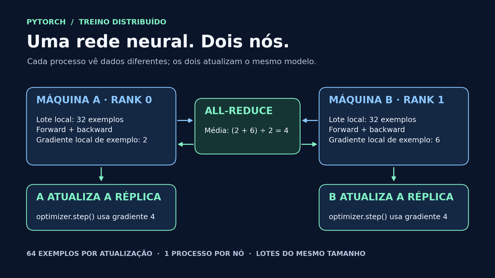
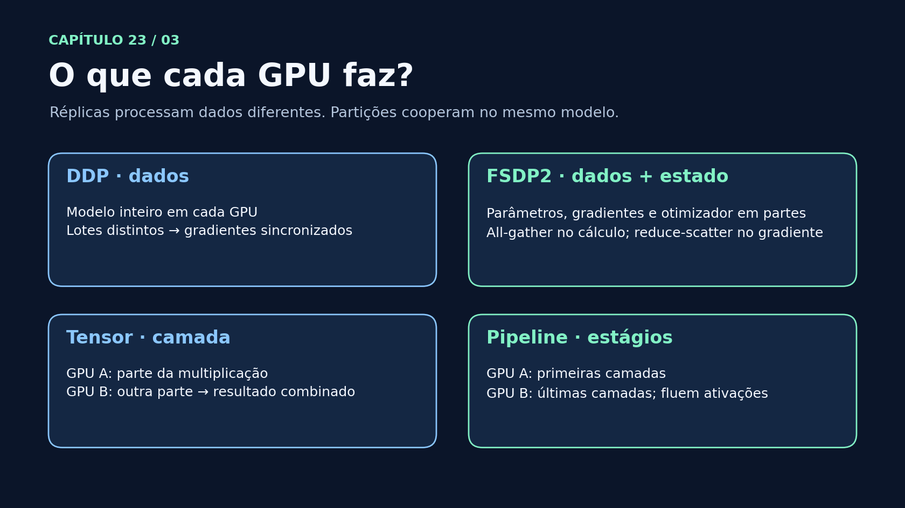
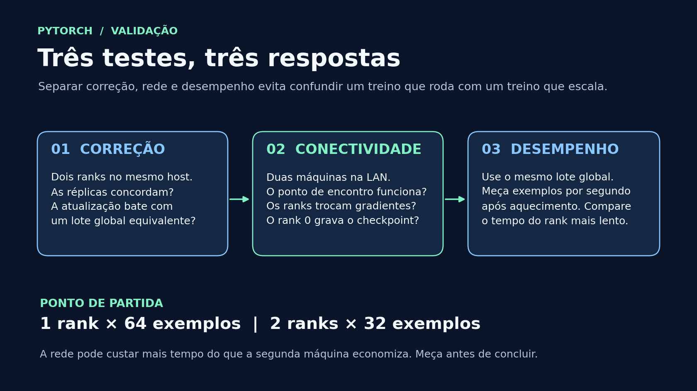
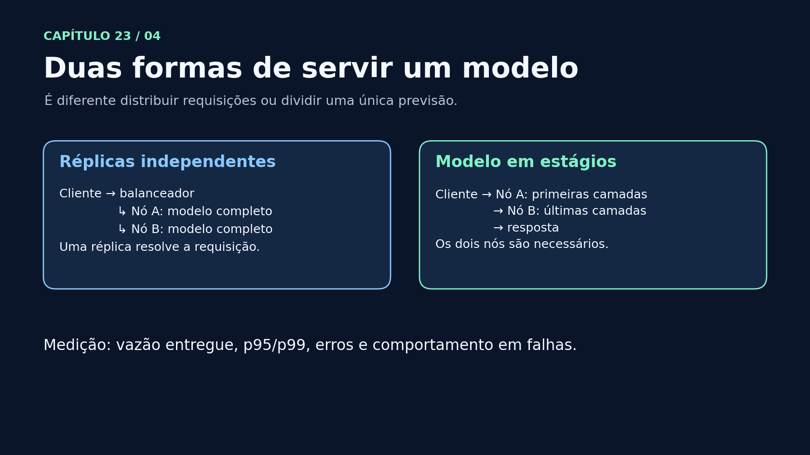

# PyTorch distribuído na prática: várias GPUs, duas máquinas e inferência

**Capítulo 23 da série ML, PyTorch e Robótica**

Imagine que você já treinou um MLP em PyTorch e quer pôr duas máquinas para trabalhar no mesmo treino. A primeira pergunta é: **o que cada máquina recebe e o que elas precisam compartilhar?** Com DistributedDataParallel (DDP), cada processo tem uma cópia inteira do modelo, recebe uma parte diferente dos dados e sincroniza os gradientes com os outros processos. Não há uma máquina treinando a primeira metade da rede e outra treinando a segunda.

Neste laboratório, vamos de dois processos em CPU ao treino em várias GPUs no mesmo servidor e em duas máquinas. Depois, reutilizamos o checkpoint para servir previsões pela rede. O modelo é pequeno e os dados são sintéticos, então dá para aprender em CPU antes de mexer com CUDA, drivers ou um dataset grande.

## 1. O que acontece em um passo de treino?



1. **No início**, o DDP sincroniza o estado inicial do modelo. Cada processo mantém sua própria réplica e seu próprio otimizador.
2. **No forward**, o rank 0 processa seu lote e o rank 1 processa outro. O DDP não separa os dados automaticamente; essa é a função do `DistributedSampler`.
3. **No backward**, o DDP sincroniza os gradientes com uma operação coletiva chamada *all-reduce*. Cada processo recebe o resultado; o rank 0 não é um servidor de parâmetros.
4. **No optimizer.step()**, cada réplica é atualizada localmente com os gradientes sincronizados. Com o mesmo modelo inicial e a mesma sequência de atualizações, as réplicas ficam alinhadas.

Um exemplo com um único peso: se cada processo calcula a média da perda sobre o mesmo número de exemplos, e os gradientes locais são 2 e 6, ambos recebem o gradiente médio 4. Com lotes locais do mesmo tamanho e sem acumulação, 32 exemplos por processo × 2 processos = **64 exemplos por atualização**. Lotes desiguais ou objetivos com denominadores diferentes, como número de tokens válidos em cada rank, exigem ponderação explícita para reproduzir a média global.

## 2. Nó, rank e dispositivo

- **Nó**: máquina que executa um ou mais processos de treino.
- **`RANK`**: identificador global do processo, de 0 a `WORLD_SIZE - 1`.
- **`LOCAL_RANK`**: identificador do processo dentro do nó. Com uma GPU por nó, os dois processos têm `LOCAL_RANK=0`, mas ranks globais diferentes.
- **`WORLD_SIZE`**: total de processos participantes. Dois nós × um processo por nó = 2.
- **Rendezvous**: ponto de encontro para que os processos se descubram. O IP e a porta apontam para o nó 0 neste exemplo. Eles não são o único caminho do tráfego: os processos também precisam se alcançar para as operações coletivas.

## 3. Prepare as duas máquinas

Use duas máquinas Linux em uma **rede privada e confiável**, com a mesma versão do Python e do PyTorch, o mesmo script e os mesmos argumentos de treino. O IP `192.168.1.10` é ilustrativo: substitua pelo IP privado do nó A. A porta `29500` deve estar livre em A e acessível de B. Permita a conectividade entre os nós para o backend, inclusive portas adicionais conforme sua infraestrutura. Não exponha o rendezvous nem desative o firewall inteiro.

Em cada máquina, no diretório do laboratório, crie um ambiente virtual e instale uma build CPU com Gloo:

```bash
python3 -m venv .venv
source .venv/bin/activate
python -m pip install torch --index-url https://download.pytorch.org/whl/cpu
python -c "import torch; print(torch.__version__, torch.distributed.is_gloo_available())"
```

Para um dataset de verdade, sincronize o manifesto, a ordem dos exemplos e as divisões de treino e validação. O exemplo sintético não precisa que um nó envie dados ao outro: os dois geram a mesma tabela usando a mesma semente. O sampler é que determina quais índices cada processo usa. Rode cada comando na máquina indicada, em terminais separados; `torchrun` não abre SSH no outro computador.

**Antes da rede: teste local com dois processos**

```bash
torchrun --standalone --nnodes=1 --nproc-per-node=2 train_ddp.py --device cpu
```

**Máquina A: lança o nó 0**

```bash
torchrun --nnodes=2 --nproc-per-node=1 --node-rank=0 \
  --master-addr=192.168.1.10 --master-port=29500 \
  train_ddp.py --device cpu
```

**Máquina B: lança o nó 1**

```bash
torchrun --nnodes=2 --nproc-per-node=1 --node-rank=1 \
  --master-addr=192.168.1.10 --master-port=29500 \
  train_ddp.py --device cpu
```

A começa esperando a outra máquina. Use o mesmo IP de A nos dois comandos; `127.0.0.1` só serve no teste em que ambos estão no mesmo computador. Os parâmetros acima descrevem um treino estático de tamanho fixo; não configuram recuperação automática se um nó cair.

## 4. As linhas que transformam treino comum em DDP

O script completo no laboratório é o que deve ser executado. Antes do loop, ele escolhe o backend, inicia o grupo com os ranks definidos pelo `torchrun`, monta o sampler e envolve o modelo com DDP. Este é um recorte da configuração em CPU, usando os nomes do laboratório:

```python
dist.init_process_group(backend="gloo", timeout=timedelta(seconds=90))
sampler = DistributedSampler(data, shuffle=True, seed=SEED)
ddp = DDP(model().to(device))
```

Dentro do loop:

```python
for epoch in range(args.epochs):
    sampler.set_epoch(epoch)
    for x, y in batches:
        x, y = x.to(device), y.to(device)
        optimizer.zero_grad(set_to_none=True)
        logits = ddp(x)
        loss = criterion(logits, y)
        loss.backward()      # DDP sincroniza os gradientes aqui
        optimizer.step()    # cada réplica atualiza seus pesos
```

O sampler recebe rank, total de processos e a mesma semente. `set_epoch` troca a ordem a cada época de forma coordenada. O laboratório garante lotes locais completos do mesmo tamanho; em outros conjuntos, um sampler pode descartar itens ou repetir índices para equilibrar as partições. Revise isso especialmente na validação: contar exemplos repetidos pode enviesar a métrica.

Para a acurácia, cada processo conta seus acertos e exemplos. A operação coletiva soma ambos, e só depois se divide: **acurácia global = soma dos acertos ÷ soma dos exemplos**. Para a perda, some as perdas por amostra, ou multiplique cada média do lote pelo tamanho do lote antes de somar. O script reporta métricas de **treino**; elas não medem generalização. Só o rank 0 imprime o resumo e grava o checkpoint. Se os discos forem independentes, o arquivo padrão, `ddp.pt`, fica no computador que hospeda o rank 0. Neste laboratório ele guarda os pesos e a época; para uma retomada fiel, salve também estado do otimizador, scheduler (se houver), RNG e progresso.

## 5. Duas GPUs NVIDIA no mesmo servidor

Se o modelo e o estado de treino cabem em uma GPU, comece com DDP. Com duas GPUs visíveis em um servidor Linux, este comando sobe um processo por GPU:

```bash
CUDA_VISIBLE_DEVICES=0,1 torchrun --standalone --nnodes=1 \
  --nproc-per-node=2 train_ddp.py --device cuda
```

Cada processo precisa associar seu `LOCAL_RANK` a um dispositivo **antes** de criar o grupo NCCL. Os índices são relativos às GPUs visíveis no processo:

```python
import os
import torch
import torch.distributed as dist
from torch.nn.parallel import DistributedDataParallel as DDP

local_rank = int(os.environ["LOCAL_RANK"])
torch.cuda.set_device(local_rank)
dist.init_process_group("nccl")
device = torch.device("cuda", local_rank)
ddp = DDP(model().to(device), device_ids=[local_rank])
```

O trecho é a configuração do treino, não um programa completo. No script do laboratório também entram o sampler, o loop e a limpeza do grupo. O processo usa apenas sua GPU; não use `RANK` como índice CUDA. Para duas máquinas com GPUs disponíveis e suporte a NCCL, mantenha a mesma topologia de rede e troque `--device cpu` por `--device cuda` **nos dois comandos**. O script seleciona NCCL e associa o processo à GPU `LOCAL_RANK`. Com duas GPUs visíveis em cada nó, use `--nproc-per-node=2` em ambos: serão quatro processos e quatro réplicas. Valide `torch.cuda.is_available()` e `torch.distributed.is_nccl_available()` nos dois lados antes. A opção CUDA/NCCL não se aplica ao MPS de Macs com Apple Silicon.

Se o modelo **não cabe em uma GPU**, acrescentar GPUs com DDP não resolve: cada uma continua mantendo o modelo inteiro. A próxima comparação é com FSDP ou outras formas de particionamento, não com mais réplicas idênticas.

## 6. Data parallelism não é model parallelism



| Técnica | O que muda | O que passa entre dispositivos |
|---|---|---|
| **DDP** | O modelo inteiro é replicado; cada processo recebe dados diferentes. | Gradientes sincronizados no backward. |
| **FSDP2** | Continua sendo data parallelism, mas particiona parâmetros, gradientes e estado do otimizador. | Faz all-gather de parâmetros quando precisa computar e reduce-scatter de gradientes no backward. |
| **Tensor parallelism (TP)** | Divide uma operação ou camada, por exemplo a matriz de uma projeção, entre GPUs. | Parciais ou ativações; a operação coletiva depende de como os tensores são divididos. |
| **Pipeline parallelism (PP)** | Separa blocos consecutivos do modelo em estágios diferentes. | Ativações no forward e seus gradientes no backward; microlotes ajudam a ocupar o pipeline. |

No TP, uma camada linear pode dividir suas colunas de entrada: se `x = [x₁, x₂]` e `W = [W₁, W₂]`, cada GPU calcula um termo e o resultado é `x₁W₁ᵀ + x₂W₂ᵀ` (some o viés uma vez). No pipeline, a GPU A pode executar as primeiras camadas enquanto a GPU B executa as últimas para outro microlote. Toda requisição ainda percorre todos os estágios. Um estágio lento ou o período em que os estágios ficam ociosos entre microlotes pode limitar o ganho.

**Minha ordem de escolha:** DDP se o estado de treino cabe; FSDP2 se a memória por GPU está limitando o treino; TP se uma camada ou sua execução precisa ser dividida; PP para repartir blocos quando o tamanho ou a topologia justificam. Pode-se combinar DP × TP × PP. Por exemplo, 8 GPUs podem formar duas réplicas independentes, cada uma com TP=2 e PP=2. Lote global conta grupos de data parallel, não todas as GPUs indiscriminadamente.

## 7. O que medir antes de comemorar



O MLP deste tutorial é pequeno. Em rede, sincronizar os gradientes pode custar mais tempo do que o trabalho que foi dividido. Para avaliar uma aceleração real:

- Compare 1 e 2 nós com o **mesmo trabalho**. Para comparação de tempo com lote global 64, use 64 em um único processo e 32 em cada um de dois processos; mantenha o total de exemplos e o protocolo de medição.
- Meça exemplos por segundo após aquecimento e repita. Compare o tempo do passo no processo mais lento; em GPU, use sincronização/eventos adequados ao cronometrar operações assíncronas.
- Relate também qualidade da validação, parâmetros, hardware, interconexão e configurações. Se crescer o lote global, você mudou o treino, não só a infraestrutura.

**O teste que rodei:** PyTorch 2.9.1, CPU/Gloo, dois comandos `torchrun` independentes, cada um com um rank de nó, conectados por TCP no mesmo Mac. Cada rank recebeu 1.024 exemplos por época. Após cinco épocas, a perda de treino caiu de **1,2089 para 0,3429** e a acurácia de treino subiu de **53,37% para 93,55%**. O maior desvio entre os pesos das duas réplicas foi **zero**; a diferença máxima em relação ao treino serial com o mesmo lote global e a mesma ordem de exemplos foi **1,192 × 10⁻⁷**. Os três testes passaram.

Isso valida a lógica do treino distribuído sobre TCP local, mas **não** mede ganho de velocidade, não comprova a conectividade de uma rede entre duas máquinas físicas e não valida CUDA/NCCL. Os comandos da seção 3 são para reproduzir o próximo teste na sua própria rede.

## 8. Se travar, descubra em qual fase

- **Para antes do primeiro passo:** os dois comandos estão ativos? O IP de A é o mesmo nos dois? Os índices são 0 e 1? A porta está livre e alcançável? Teste a conectividade entre as máquinas, não só a internet.
- **Encontra os processos, mas trava na sincronização:** confirme que os dois lados entram nas mesmas operações coletivas na mesma ordem. Não coloque o `all_reduce` dentro de `if rank == 0`; todos os ranks devem participar.
- **Rede incorreta escolhida automaticamente:** em máquinas com Docker, VPN e Wi-Fi, inspecione qual interface realmente liga os nós. Quando necessário, defina `GLOO_SOCKET_IFNAME` (CPU) ou `NCCL_SOCKET_IFNAME` (CUDA) com a interface correta de cada máquina. Para diagnóstico, `TORCH_DISTRIBUTED_DEBUG=DETAIL` e, no NCCL, `NCCL_DEBUG=INFO`.
- **Gradientes corretos, treino pior:** confira se o lote global mudou, se o sampler cobre os índices como esperado e se as métricas são calculadas sobre uma validação separada.

**Para levar à robótica:** dá para usar o mesmo padrão para aprender com imagens ou trajetórias já coletadas. Distribuir o treino do modelo e distribuir simuladores que **coletam** novas experiências são problemas diferentes. DDP resolve o primeiro; não distribui MuJoCo ou AirSim sozinho.

## 9. Inferência: duas réplicas ou um modelo dividido?



**Duas réplicas:** cada máquina carrega o mesmo checkpoint. O cliente faz uma chamada ao balanceador, que escolhe uma réplica pronta; ela devolve a previsão inteira. Não há DDP, sincronização de gradientes nem dependência da segunda máquina para completar cada chamada. Esse desenho aumenta capacidade e resiliência quando há carga suficiente, não promete reduzir a latência de uma requisição.

**Um modelo dividido:** a máquina A roda o começo da rede e envia ativações à máquina B, que termina a previsão. Isso é útil quando o modelo não cabe inteiro, mas as duas partes precisam responder para completar a chamada. Cada travessia consome banda e soma latência. Em Transformers autoregressivos, TP entre hosts pode exigir coletivas a cada camada e token; quando a topologia permite, mantenha grupos TP no mesmo domínio de interconexão rápida e meça o custo de cruzar nós. Não trate o exemplo didático de HTTP como um runtime de produção de LLM.

### Laboratório: reutilize o checkpoint do DDP para servir o MLP

Rode os comandos em terminais separados, usando a mesma cópia confiável de ddp.pt nos dois workers. Para o teste local:

```bash
# Réplica A
python serve_ddp.py --checkpoint ddp.pt --role replica --host 127.0.0.1 --port 8000 --id R0
# Réplica B
python serve_ddp.py --checkpoint ddp.pt --role replica --host 127.0.0.1 --port 8001 --id R1
# Cliente (rodízio didático)
python infer_client.py --endpoint http://127.0.0.1:8000 --endpoint http://127.0.0.1:8001 --requests 12
```

Em duas máquinas, troque o bind de cada servidor pelo IP privado local real e aponte o cliente aos dois IPs. Em produção, use um balanceador dedicado; o cliente demonstrativo só alterna entre os endpoints e tenta o outro na falha.

Para dividir a rede, comece pelo B e aponte o cliente apenas ao A:

```bash
# Estágio B: produz os logits a partir das ativações
python serve_ddp.py --checkpoint ddp.pt --role stage-b --host 127.0.0.1 --port 8101 --id B
# Estágio A: calcula a primeira parte e chama B
python serve_ddp.py --checkpoint ddp.pt --role stage-a --host 127.0.0.1 --port 8100 --id A --peer http://127.0.0.1:8101
# Cliente
python infer_client.py --endpoint http://127.0.0.1:8100 --requests 12
```

O exemplo usa JSON e HTTP em rede privada confiável. Cada worker carrega o checkpoint inteiro na inicialização e só depois retém a sua parte; para um modelo que nem cabe na inicialização, use carregamento particionado de verdade.

**O que medi em TCP local:** 12 requisições sequenciais deram 6 em cada réplica. Ao desligar R0, a requisição seguinte foi refeita em R1. No modelo dividido, os logits ficaram idênticos aos do caminho local no teste (diferença máxima zero). Ao desligar B, A sinalizou indisponibilidade no readiness (503) e falha no predict (502). Quatro testes de inferência passaram. Isso verifica roteamento e equivalência no mesmo Mac, não capacidade, alta disponibilidade, aceleração ou rede entre hosts físicos.

## 10. Como ligar as máquinas em produção

1. **Comece pela topologia.** Use IPs privados roteáveis, nós na mesma região/zona de baixa latência quando possível e conectividade bilateral. Em um servidor, inspecione GPU ↔ GPU e GPU ↔ NIC com `nvidia-smi topo -m`. PCIe pode bastar; NVLink/NVSwitch acelera trocas onde o hardware oferece suporte. Reserve rede rápida para tráfego de treino que realmente a aproveita.
2. **Meça cada camada separadamente.** Verifique RTT e vazão TCP com uma ferramenta como `iperf3` na rede privada; para CUDA, compare as coletivas representativas com NCCL Tests e localize esperas no profiler. Para clusters exigentes, avalie InfiniBand ou Ethernet com RoCE e GPUDirect RDMA, depois valide drivers, NICs, switches e a configuração de congestionamento. A velocidade nominal do link não é o throughput do treino.
3. **Reproduza o mesmo workload.** Compare 1 GPU, várias no mesmo nó e o mesmo total em mais de um nó. Mantenha lote global, exemplos, precisão e configuração de validação. Reporte exemplos/s, tempo por passo, memória, utilização e fração do passo gasta na comunicação. Lote efetivo = lote por rank × ranks de data parallel × passos de acumulação. Use checkpoint em armazenamento durável e um orquestrador para relançar, monitorar e reiniciar; o encontro do torchrun não é, por si só, uma estratégia de recuperação.
4. **Separe a rede de serviço da de treino.** Em inferência, exponha o gateway com TLS e autenticação conforme seu ambiente; mantenha workers privados. Use readiness, limites de fila, timeouts, concorrência medida e janela de warm-up. Compare uma e duas réplicas com a mesma taxa oferecida e registre req/s concluídas, erros, filas ou descartes, p95 e p99. Em LLMs, meça também tempo até o primeiro token (TTFT), tempo entre tokens e tokens/s. Teste a queda de um worker separadamente; retries precisam respeitar a operação e o orçamento de tempo.

**Laboratório reproduzível:** [scripts, testes e diagramas no GitHub](https://github.com/vanedaltro/ml_rl_robotics/tree/main/capitulos/23-pytorch-distribuido).

### Referências oficiais

- [torchrun: argumentos e execução multinó](https://docs.pytorch.org/docs/stable/elastic/run.html)
- [DDP: API e responsabilidades do usuário](https://docs.pytorch.org/docs/stable/generated/torch.nn.parallel.DistributedDataParallel.html)
- [torch.distributed: backends e diagnóstico](https://docs.pytorch.org/docs/stable/distributed.html)
- [DistributedSampler: partições e set_epoch](https://docs.pytorch.org/docs/stable/data.html#torch.utils.data.distributed.DistributedSampler)
- [PyTorch Distributed Overview: DDP, FSDP2, TP e PP](https://docs.pytorch.org/tutorials/beginner/dist_overview.html)
- [PyTorch Pipeline Parallelism](https://docs.pytorch.org/docs/stable/distributed.pipelining.html)
- [NVIDIA NCCL: rede, interconexão e diagnóstico](https://docs.nvidia.com/deeplearning/nccl/user-guide/docs/troubleshooting.html)
- [NVIDIA NCCL Tests](https://github.com/NVIDIA/nccl-tests)
