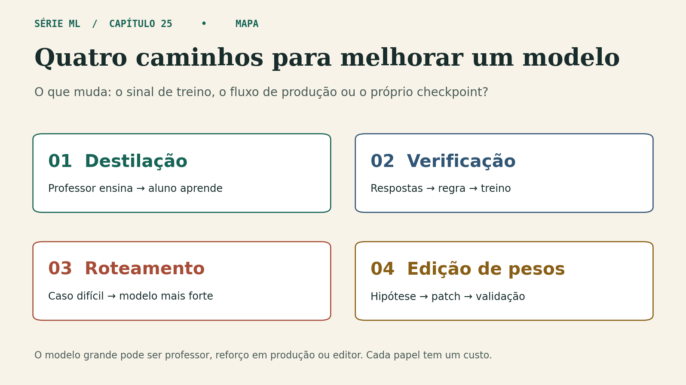
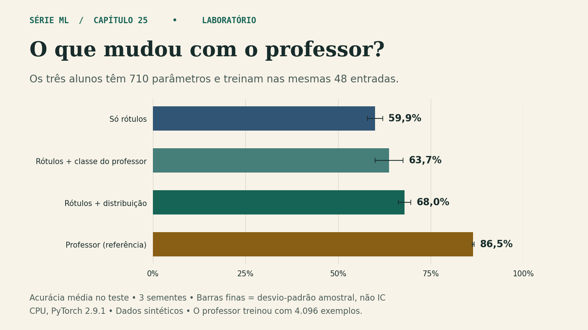
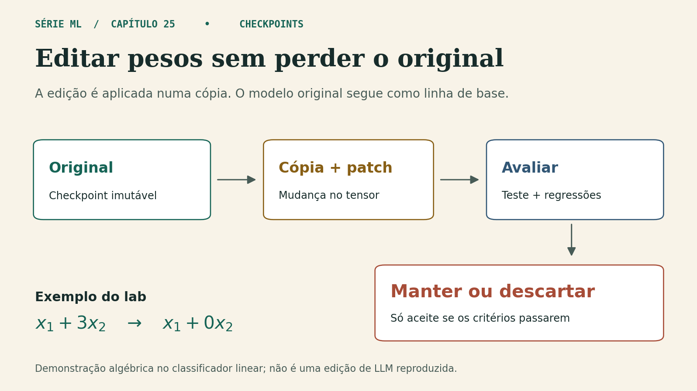

# Como um modelo pequeno aprende com um grande: destilação, dados sintéticos e edição de pesos

**Capítulo 25 · Série PyTorch, LLMs e Robótica**

Imagine um classificador local que precisa encaminhar chamados de suporte, mas só tem 48 exemplos rotulados. Um modelo melhor pode dizer simplesmente “rede”, ou mostrar que “infraestrutura” também era plausível e que “financeiro” quase certamente não era. Será que vale a pena ensinar o aluno a reproduzir essa distribuição?

Neste capítulo, testamos essa ideia em PyTorch. Depois, vamos separar quatro estratégias que parecem iguais por fora: ensinar com um professor, treinar com um verificador, pedir ajuda em produção e editar diretamente um checkpoint.



## 1. Destilação: o professor ensina antes da publicação do modelo

**Destilação de logits** funciona quando temos acesso a pontuações comparáveis. Em classificação, professor e aluno precisam ter as mesmas classes na mesma ordem. Em um LLM autoregressivo, uma KL por token exige que as distribuições estejam alinhadas, o que não se resolve só usando dois modelos parecidos. Uma API que devolve texto ou poucos logprobs não entrega automaticamente a distribuição completa.

Veja a diferença: um rótulo diz **rede**. Uma distribuição, por exemplo, diz **[0,72 rede; 0,25 infraestrutura; 0,03 financeiro]**. O segundo alvo carrega informação sobre a confusão entre classes. Na receita clássica de [Hinton, Vinyals e Dean](https://arxiv.org/abs/1503.02531), aplicamos a temperatura `T` aos logits do professor e do aluno. Quanto maior T, mais suave a distribuição. A temperatura de treino não precisa mudar a usada no deploy.

$$
p_i^{(T)}=\operatorname{softmax}(z_i/T),\qquad
\mathcal L=(1-\alpha)\,\mathrm{CE}(z_S,y)+
\alpha T^2D_{\mathrm{KL}}\!\left(p_P^{(T)}\parallel p_S^{(T)}\right).
$$

Aqui, `P` é professor, `S` é aluno e `y` é o rótulo verdadeiro. O fator T² compensa a escala do gradiente do termo suave na formulação clássica. No PyTorch, a ordem dos argumentos é importante: `kl_div` recebe o **log** das probabilidades do aluno primeiro e as probabilidades do professor em seguida.

```python
import torch.nn.functional as F

def distillation_loss(student, teacher, labels, T=3.0, alpha=0.75):
    soft = F.kl_div(
        F.log_softmax(student / T, dim=-1),
        F.softmax(teacher.detach() / T, dim=-1),
        reduction="batchmean",
    )
    hard = F.cross_entropy(student, labels)
    return (1 - alpha) * hard + alpha * T**2 * soft
```

**Quando só temos o texto**, podemos treinar o aluno por SFT com demonstrações permitidas e verificadas: pergunta → resposta esperada. Isso é destilação por saídas ou imitação de sequências, não KL sobre logits escondidos. Professor e aluno podem usar tokenizadores diferentes nesse caso: o aluno tokeniza o texto por conta própria. Uma extensão é pedir uma **justificativa ensinável**, como os passos de uma conta que o leitor pode conferir. Uma explicação gerada pode estar errada mesmo quando o resultado final está certo. [Distilling Step-by-Step, ACL](https://aclanthology.org/2023.findings-acl.507/).

**Dados sintéticos vão além da imitação.** Um professor pode propor perguntas, criar paráfrases, gerar contraexemplos ou rotular candidatos. Um gerador de regras também pode criar milhares de problemas e respostas sem LLM nenhum. Depois vêm os filtros: esquema, duplicatas, verificação e cobertura das classes difíceis. Separe treino e teste por problema, família de template ou origem **antes** de gerar variações; mudar só os números de uma questão pode deixar a mesma estrutura nos dois lados.

### Dois exemplos documentados

- **DeepSeek-R1-Distill:** os autores ajustaram modelos-base Qwen e Llama com cerca de **800 mil exemplos** curados da cadeia de treinamento do R1. O relatório descreve SFT dos alunos nesse estágio, não o mesmo ciclo de RL do professor nem imitação direta dos seus logits. A documentação sustenta esse caminho; não é evidência de uso de uma API externa específica. [Artigo DeepSeek-R1](https://arxiv.org/abs/2501.12948) · [Modelos e licenças](https://github.com/deepseek-ai/DeepSeek-R1).
- **Orca e Phi-4:** o projeto Orca explora aprender com explicações de professores mais fortes; o relatório do Phi-4 descreve uma mistura de dados naturais e sintéticos ao longo do treino. Os autores reportam ganhos em tarefas específicas de STEM. Um aluno pode ganhar do professor em uma tarefa bem delimitada sem ganhar dele em tudo. [Microsoft Research: Orca](https://www.microsoft.com/en-us/research/project/orca/) · [Relatório Phi-4](https://www.microsoft.com/en-us/research/publication/phi-4-technical-report/).

## 2. Laboratório: o mesmo aluno e três sinais de treino

Treinei um professor de 64 unidades por camada com 4.096 exemplos. Para cada semente, três alunos idênticos, de 16 unidades por camada, receberam as mesmas **48 entradas**, a mesma inicialização e o mesmo orçamento de passos. Só mudou a perda: rótulo real, rótulo real + classe escolhida pelo professor, ou rótulo real + distribuição do professor. Os dados são sintéticos: seis classes que se sobrepõem num plano e 18 dimensões de ruído. O conjunto de teste tem 2.048 exemplos independentes por semente.



- **Aluno só com rótulos:** 59,9% de acurácia média.
- **Aluno com a classe escolhida pelo professor:** 63,7%.
- **Aluno com a distribuição completa:** 68,0%. Ganho de **8,0 pontos percentuais** sobre a linha de base.
- **Professor:** 86,5%. Ele tinha mais dados e uma arquitetura maior. É uma referência, não uma comparação em igualdade de recursos.

Resultado de três sementes (7, 23, 42), em CPU, no PyTorch 2.9.1. São **710 parâmetros** no aluno e **5.894** no professor. Todos os alunos têm o mesmo custo arquitetural de inferência; o ganho medido aqui é de **acurácia**, não de latência. O professor sai de cena após o treino. O teste não mede LLMs, não promete ganhos em outros dados e não implica economizar o custo total: o professor já veio de um treino maior.

```bash
python -m pip install torch
python lab.py
python -m unittest -v test_lab.py
```

O laboratório inclui as três comparações, as sementes, os dados sintéticos e uma edição simples de pesos. [Repositório da série PyTorch, LLMs e Robótica](https://github.com/vanedaltro/ml_rl_robotics).

## 3. Quando o sinal vem de um verificador, e não de um professor

Considere a tarefa de converter **2,5 kg em gramas**. Um modelo gera quatro respostas. Um verificador determinístico confere o valor e a unidade. A partir daí há duas rotas:

- **Rejection sampling + SFT:** conservar as respostas que passaram e treinar depois para imitá-las. Respostas rejeitadas não entram como alvos.
- **RLVR (reinforcement learning with verifiable rewards):** transformar o resultado do verificador em recompensa para atualizar a política que gera as respostas. Em **GRPO**, várias amostras do mesmo problema dão uma referência relativa para as recompensas, sem um crítico separado na formulação usual. Gerar amostras continua custando memória e tempo. [DeepSeekMath, que introduz GRPO](https://arxiv.org/abs/2402.03300) · [DeepSeek-R1](https://arxiv.org/abs/2501.12948).

O verificador pode virar o próprio problema. Se ele aceitar qualquer texto que contenha “2500”, pode premiar “2500 miligramas”. Teste número, unidade e formato separadamente, pense em casos que deveriam falhar e reserve testes que o modelo nunca vê. Testes para programas têm a mesma limitação: passar num conjunto finito não prova correção geral. Em **agentic RL**, além de avaliar a resposta, podemos avaliar o resultado de ações num ambiente controlado, como um agente que corrige uma função em um repositório de brinquedo e precisa passar em testes ocultos.

[**DAPO**](https://arxiv.org/abs/2503.14476) e [**GSPO**](https://arxiv.org/abs/2507.18071) são exemplos de algoritmos que alteram como se amostra e otimiza esse tipo de sinal. GSPO trabalha com a razão de probabilidades no nível da sequência. São escolhas de treino, não maneiras de acessar o conhecimento de uma API.

### E se duas respostas estiverem corretas, mas uma for mais útil?

Se a preferência é “clara, curta e pede a informação que falta”, usar apenas resposta certa/errada não dá conta. **DPO** aprende de pares preferida/rejeitada, comparando a diferença das log-probabilidades com a de uma política de referência; dispensa um modelo de recompensa separado. **SimPO** e **ORPO** propõem objetivos que dispensam essa referência. **KTO** aceita exemplos marcados como desejáveis ou indesejáveis, sem exigir pares do mesmo prompt. Em **RLHF/RLAIF**, o feedback humano ou de IA pode alimentar uma etapa de alinhamento; um juiz de IA pode ser calibrado com humanos e avaliado por viés de ordem, comprimento e estilo. [DPO](https://arxiv.org/abs/2305.18290) · [SimPO](https://arxiv.org/abs/2405.14734) · [ORPO](https://arxiv.org/abs/2403.07691) · [KTO](https://arxiv.org/abs/2402.01306) · [Constitutional AI](https://arxiv.org/abs/2212.08073).

**Self-play** é outra forma de gerar sinal: em [SPIN](https://arxiv.org/abs/2401.01335), versões anteriores do próprio modelo geram respostas para contrastar com demonstrações humanas. Em [SPICE](https://arxiv.org/abs/2510.24684), dois papéis no mesmo modelo criam e respondem a perguntas com base em um corpus. O desafio é evitar que o ciclo reforce erros próprios. Âncoras externas ajudam: dados humanos, documentos, regras e testes novos. E se a lacuna for familiaridade com o vocabulário de um domínio, o **pré-treino continuado** em textos autorizados é mais uma opção. Isso é diferente de SFT para ensinar o formato de uma resposta. Para fatos que mudam toda semana, eu começaria pela recuperação de documentos (RAG).

## 4. Se o modelo grande só aparece em produção, os pesos do pequeno não mudam

- **Roteamento antes da resposta:** o roteador manda casos rotineiros para o modelo local e casos sinalizados como difíceis para um modelo mais forte. [RouteLLM](https://arxiv.org/abs/2406.18665).
- **Cascata depois da resposta:** o modelo local tenta primeiro. Se uma regra detectar JSON inválido ou faltar evidência suficiente, o sistema pode subir o caso, pedir esclarecimento ou encaminhar a uma pessoa. A confiança verbal do modelo não é um critério suficiente.
- **Decodificação especulativa:** o modelo pequeno propõe **tokens**, e o grande os verifica durante a geração. A formulação clássica preserva a distribuição do modelo grande quando implementada corretamente; o ganho de velocidade depende da taxa de aceitação, da implementação e do hardware. Não é uma cascata de atendimento nem uma melhora de qualidade do pequeno. [Leviathan et al., ICML](https://proceedings.mlr.press/v202/leviathan23a.html).

Em produção, meça acerto por categoria, taxa de encaminhamento, **custo por tarefa resolvida**, latência p95 e taxa de falhas. Por exemplo, com 1.000 pedidos, custo local de 1 unidade por pedido e 100 escaladas de 20 unidades, a cascata custa 3.000 unidades. Enviar tudo direto ao modelo grande custaria 20.000. É conta ilustrativa: ela só justifica a troca se a qualidade ficar dentro da meta e se incluir o custo de checagem, infraestrutura e tentativas repetidas.

## 5. Fronteira da pesquisa: um LLM pode editar os pesos de outro?



Em **weight-space programming**, o editor propõe scripts que calculam alterações em tensores de um checkpoint acessível. Ele pode examinar ativações e testar hipóteses na validação. Nos trabalhos abaixo, a atualização é escrita diretamente, sem descida de gradiente nessa etapa. Isso exige acesso aos pesos **do alvo**. O editor pode ser outro modelo servido por API, mas isso não dá acesso aos pesos do editor. A edição custa inspeção, execuções e validação, mesmo que não acrescente uma chamada por resposta depois.

- **Sparks of Weight-Space Programming (nov/2026):** os autores relatam que um editor mudou **131.072 pesos** (cerca de **0,016%**) do **Qwen3.5-0.8B**, e o MATH-500 foi de **7,9% a 48,1%**, com os mesmos ajustes de amostragem. Nessa configuração, o modelo original atingia o limite de geração em **93%** das respostas do benchmark; após a edição, **33%**. Num Gemma 3 270M que já raramente entrava em loop, o estudo não estabeleceu ganho comparável. O resultado é mais bem lido como remoção de um gargalo específico do que como prova de que o editor ensinou matemática nova. [Relato dos autores, com protocolo e ablações](https://rikiyat.github.io/blog/weight-space-programming/).
- **Language Models Can Rewrite Their Own Weights (preprint, nov/2026):** um modelo de **27B** testou edições dos próprios pesos. Em um protocolo, uma edição teve **+6,6 pontos percentuais** em **490 problemas reservados**, de 57,2% para 63,8% na média por problema. Cinco das oito sessões iniciais no protocolo não mantiveram edição. O trabalho também mostra um reparo numa cópia danificada de propósito. Os resultados não estabelecem um tamanho mínimo universal nem autoaperfeiçoamento ilimitado. [Fan et al., v2, Tabela 13](https://arxiv.org/html/2611.21885v2).
- **Weight-Space Programming Doesn't Need Transformers (preprint, nov/2026):** em tarefas sobretudo de múltipla escolha, os editores criaram estruturas parecidas com tabelas esparsas quando puderam escolher a arquitetura. Os autores dizem que os LLMs pré-treinados continuaram mais precisos. É um estudo sobre o que construir **quando se escreve os pesos**, não uma conclusão sobre substituir Transformers na prática. [Ok e Lee](https://arxiv.org/abs/2611.22055).

### Uma analogia em miniatura, sem LLM

No laboratório, o sinal correto é o sinal de `x1`. Sabemos de propósito que `x2` é uma distração. O escore original é `x1 + 3*x2`. A edição troca o peso 3 por 0: no exemplo de quatro entradas, passa de **2/4 para 4/4 acertos**. Restaurar a cópia recupera as respostas originais. É uma demonstração algébrica transparente, não uma reprodução dos estudos nem um experimento de descoberta autônoma do erro.

Em um checkpoint real, nunca conclua que uma camada é culpada só porque editar o peso melhorou dez exemplos. Preserve o original, compare contra uma linha de base, controle os limites de geração e teste em dados reservados. Meça também regressões em tarefas antigas, como vimos no [capítulo sobre fine-tuning e esquecimento](https://www.linkedin.com/pulse/fine-tuning-sem-esquecer-do-mlp-aos-adapters-de-llms-santos-daltro-bv2se/). Se a edição não passar, descarte-a.

## Para decidir no seu projeto

1. **Quer ensinar uma habilidade estável e específica?** Comece com exemplos licenciados, um aluno de referência e SFT. Teste destilação suave se houver acesso a distribuições alinhadas. Se quiser alterar poucos parâmetros, use LoRA como mecanismo de ajuste; ele não determina de onde vem o sinal de treino.
2. **Você consegue verificar o acerto com uma regra confiável?** Comece com amostragem e filtragem. Experimente RLVR quando houver margem para melhorar por tentativa e erro e você puder testar o verificador.
3. **Quer reduzir custo sem retreinar?** Experimente uma cascata e meça o custo e a qualidade juntos. Para acelerar os tokens do modelo-alvo, teste decodificação especulativa separadamente.
4. **O problema parece uma falha localizada nos pesos?** Trate edição direta como pesquisa e tenha estado original, avaliação reservada e rollback.

**Antes de usar um professor pago:** confirme se o contrato autoriza usar as saídas para treino, o que pode ser retido, enviado ou redistribuído e quais dados podem sair do ambiente. Pagar pela API não dá permissão automática para treinar alunos com as respostas. Algumas ofertas têm restrições e exceções específicas, como exemplifica o [contrato de serviços da OpenAI](https://openai.com/policies/services-agreement/). Prefira um professor local licenciado ou um acordo que permita expressamente o uso pretendido. No laboratório não há tráfego externo, dados de clientes ou API paga. E **pesos abertos** não significam necessariamente código, informações sobre dados e direitos suficientes para se enquadrar na [definição de IA open source da OSI](https://opensource.org/ai/open-source-ai-definition).

Se eu tivesse de escolher o primeiro passo, começaria com **um conjunto de teste pequeno, mas independente**, e o aluno mais simples que puder medir. Só depois decidiria se o modelo grande tem mais valor como professor, como reforço em produção ou como ferramenta de pesquisa.
