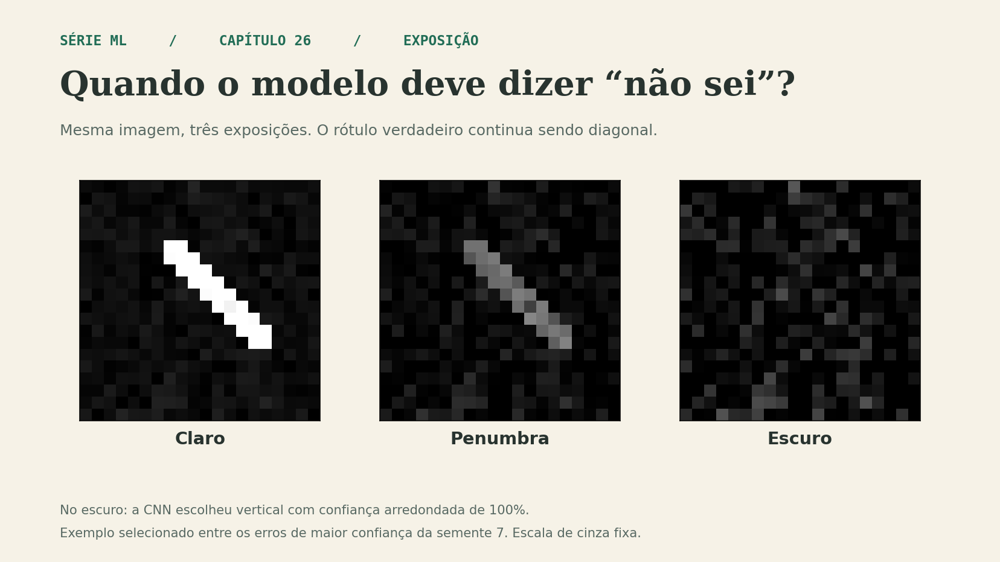
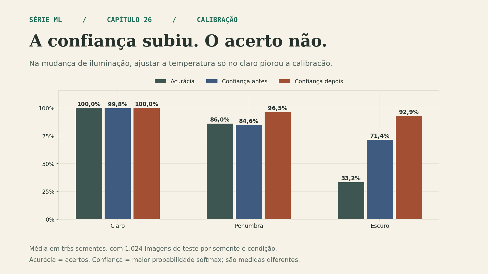
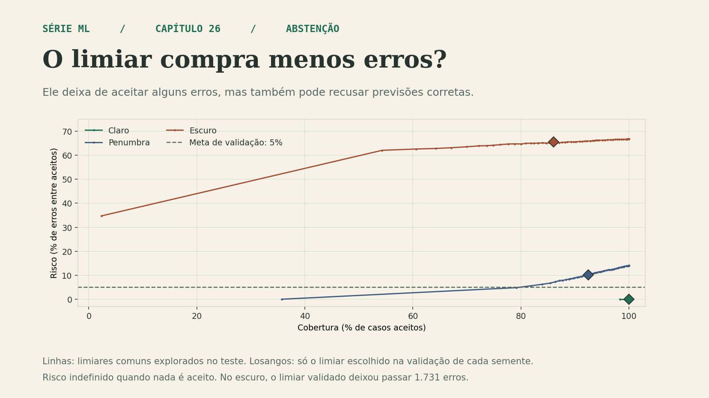
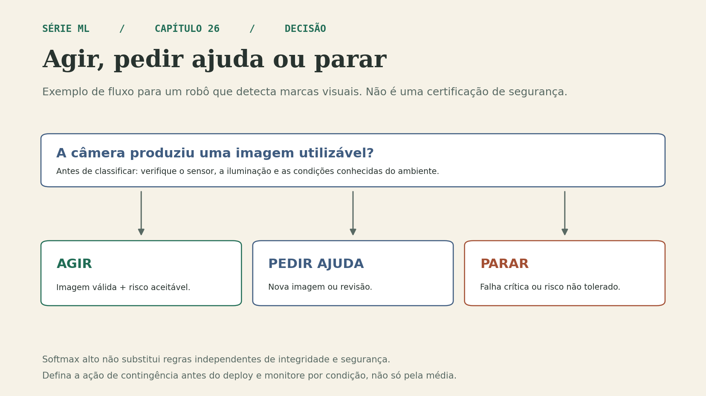

# Quando o modelo deve dizer “não sei”? Calibração, imagens no escuro e a opção de parar

**Capítulo 26 · Série PyTorch, LLMs e Robótica**

A câmera do nosso robô vê uma marca diagonal. No claro, é fácil reconhecê-la. Com pouca luz, a imagem vira uma mistura de bordas fracas e ruído. A rede, porém, continua obrigada a escolher entre quatro classes. Numa das imagens escuras do laboratório, ela respondeu **“vertical” com confiança arredondada de 100%**. O rótulo era diagonal.

Este é o problema do capítulo: **como decidir quando usar uma previsão, pedir uma segunda observação ou parar?** Vamos escurecer imagens, medir o que acontece com a confiança e testar se um limiar realmente evita erros.



## 1. Acurácia, confiança e calibração respondem perguntas diferentes

- **Acurácia:** de todas as previsões, quantas estavam certas?
- **Confiança:** qual foi a maior probabilidade que o modelo atribuiu às suas classes para esta imagem? Neste laboratório, usamos a saída do softmax.
- **Calibração:** entre os casos em que o modelo disse “por volta de 80%”, acertou por volta de 80% das vezes?

Um modelo pode acertar bastante e ainda dar notas de confiança ruins. Também pode estar bem calibrado e ser pouco útil: se ele sempre disser “60%” e acertar 60%, a calibração agregada parece boa, mas o número não ajuda a separar casos fáceis de difíceis. E uma previsão isolada com confiança de 80% não vem com um carimbo de garantia.

O **diagrama de confiabilidade** divide as previsões em faixas. Em cada faixa, compara a confiança média com a fração observada de acertos. Se o grupo com confiança média de 90% só tem 60% de acertos, existe um desvio de 30 pontos percentuais. O **ECE** (erro esperado de calibração) calcula a média ponderada desses desvios absolutos. Ele depende das faixas escolhidas e pode esconder problemas de uma classe rara ou de um ambiente específico. A **NLL** (perda logarítmica) mede quanto o modelo apostou na classe verdadeira e penaliza fortemente atribuir a ela probabilidade quase zero. [Guo et al., ICML](https://proceedings.mlr.press/v70/guo17a.html).

## 2. O que exatamente ficou fora da distribuição?

**Mudança de distribuição:** escurecemos as imagens e adicionamos ruído, mas as quatro classes conhecidas continuam sendo vertical, horizontal, diagonal e anel. A marca não muda só porque a câmera perdeu luz.

**Classe desconhecida:** mandamos à rede imagens claras de uma quinta forma, a cruz. O modelo não foi treinado com essa classe. Sem uma regra de rejeição, só consegue escolher uma das quatro opções que conhece. O softmax distribui 100% da massa entre essas opções, mesmo quando nenhuma faz sentido. Uma pontuação baixa pode ajudar a sinalizar dúvida; uma alta não prova que a entrada é familiar. [Hendrycks e Gimpel, baseline com softmax máximo](https://arxiv.org/abs/1610.02136).

Essa separação é importante em produção. A primeira falha pode pedir outra foto, iluminação melhor ou validação em um novo ambiente. A segunda pode exigir ampliar o catálogo de classes ou usar um mecanismo próprio de detecção de entradas desconhecidas.

## 3. Laboratório: treinar no claro, testar no escuro

Usamos **PyTorch 2.9.1 em CPU**, uma CNN pequena, imagens sintéticas de 20×20 e três sementes (7, 23, 42). Por semente, são **2.048 imagens claras de treino**, **512 claras para ajustar a temperatura**, **1.024 para escolher o limiar** (metade claras, metade em penumbra) e **1.024 amostras de teste geradas com uma semente separada**. Cada geometria de teste é renderizada nas três condições. Isso torna a comparação entre exposições pareada: são 3.072 imagens por condição somando sementes, não três conjuntos independentes de geometrias. A cruz tem mais 512 exemplos por semente.

A simulação reduz o sinal de pixel e adiciona ruído antes de limitar o valor ao intervalo [0, 1]. Os fatores de sinal foram 1,00, 0,42 e 0,10; os desvios do ruído, 0,035, 0,07 e 0,13. Esses números descrevem a **simulação**, não lux ou sensibilidade de uma câmera real.

### Ajustando a temperatura sem retreinar

Dividimos os logits por um escalar positivo antes do softmax. A rede e a classe escolhida continuam as mesmas. Se T for maior que 1, as probabilidades ficam mais suaves. Se for menor que 1, a rede fala com mais confiança. Escolhemos T minimizando a NLL no conjunto claro de calibração, numa grade delimitada de 0,25 a 4.

$$
p_T(y=k\mid x)=[\mathrm{softmax}(z(x)/T)]_k,qquad
\hat y=\mathop{\mathrm{argmax}}_k z_k(x),qquad T>0.
$$

Nos três treinos, **T = 0,25**, o piso permitido. A CNN acertou todo o teste claro e as previsões já eram muito confiantes ali. Esse resultado no limite é um sinal de que o conjunto fácil quase não informa como tratar erros. De fato, apertar a distribuição ajudou a NLL **no claro** (de 0,0018 para cerca de 0,000002), mas piorou a NLL **no escuro** (de 2,08 para 6,94). Isso ilustra por que calibrar em uma distribuição não garante calibração em outra. [Ovadia et al., avaliação sob mudança de distribuição](https://arxiv.org/abs/1906.02530).



- **Claro:** 100% de acerto. ECE médio de aproximadamente 0,18 ponto percentual antes, praticamente zero depois.
- **Penumbra:** 86,0% de acerto. O ECE subiu de **4,6 para 10,7 pontos percentuais**.
- **Escuro:** 33,2% de acerto. O ECE subiu de **38,2 para 59,7 pontos percentuais**. Dos 2.051 erros, **237** tinham confiança de pelo menos 90% antes. Depois, foram **1.543**, ainda com as mesmas classes escolhidas.

ECE com dez faixas de largura igual, calculado por semente e depois promediado. As contagens foram somadas. Não se deve extrapolar estes valores para imagens reais ou para outras arquiteturas.

## 4. Um limiar ajuda? Conte os erros que sobraram

A regra de classificação seletiva aceita um caso quando a confiança `c` supera ou iguala o limiar `τ`. Quando o modelo se abstém, a resposta precisa ser outra que não simplesmente escolher a segunda classe.

$$
\mathrm{cobertura}=\frac{\#\mathrm{aceitos}}{\#\mathrm{casos}},\qquad
\mathrm{risco\ seletivo}=\frac{\#\mathrm{erros\ entre\ aceitos}}{\#\mathrm{aceitos}}.
$$

Em cada semente, experimentamos uma grade de limiares **só na validação da política**. Escolhemos o de maior cobertura com **até 5% de erros entre aceitos** na mistura clara + penumbra, e exigimos pelo menos 100 aceitações. Os limiares encontrados foram 0,87, 0,64 e 0,87. Se nenhum atingisse o critério, o código não autorizaria aceitação automática. O risco quando nada é aceito é **indefinido**, não zero.



Na tabela abaixo, todos os resultados são no **teste**, e as contagens somam as três sementes. “Corretos recusados” conta casos que a CNN teria acertado, mas que o filtro mandou para outra rota.

| Cenário | Sem filtro: erros | Com limiar: erros aceitos | Corretos recusados | Cobertura | Risco entre aceitos |
| --- | ---: | ---: | ---: | ---: | ---: |
| Claro | 0 | 0 | 0 | 100,0% | 0,0% |
| Penumbra | 430 | 289 | 90 | 92,5% | 10,2% |
| Escuro | 2.051 | 1.731 | 109 | 86,0% | 65,5% |

No escuro, o limiar **deixou de aceitar 320 erros**, mas permitiu **1.731** e encaminhou **109 previsões corretas**. Mesmo usar 0,90 fixo após o ajuste deixa passar **1.543 erros** com 77,6% de cobertura e 64,7% de risco. Já nas imagens claras da cruz, o limiar aceitou **1.316 de 1.536** entradas cuja classe o modelo nem conhecia.

O recorte por condição mostra por que a meta de 5% na validação não é promessa. A validação misturava casos fáceis e difíceis e nunca viu escuridão severa nem a classe nova. Os pontos da curva no teste ajudam a **diagnosticar** o problema; não use o teste para escolher o próximo limiar e depois chamar esse mesmo resultado de validação. [Geifman e El-Yaniv, previsão com opção de rejeição](https://proceedings.mlr.press/v97/geifman19a.html).

### O código que decide se a rede responde

```python
def decidir(logits, temperature, tau, imagem_valida, falha_critica):
    if falha_critica:
        return "parar"

    if not imagem_valida or tau is None:
        return "pedir ajuda"

    confidence, prediction = (logits / temperature).softmax(-1).max(-1)
    if confidence.item() < tau:
        return "pedir ajuda"

    return "agir", prediction.item()
```

Exemplo para uma única imagem. O laboratório mede somente a parte do **limiar**. Os indicadores `imagem_valida` e `falha_critica` representam sinais de fora da rede, como falha de câmera ou condição fora do envelope validado. O diagrama mostra onde ligá-los; no laboratório eles não foram avaliados nem substituem validação de segurança.



## 5. O que eu faria antes de colocar isso num robô?

1. **Validaria a imagem antes de confiar na classe.** Verificaria se há captura recente e utilizável, iluminação e contraste dentro do intervalo operacional, e se uma nova foto resolve. Uma câmera coberta pode gerar uma decisão de parada mesmo quando a rede insiste em 99%.
2. **Definiria custos e uma saída para cada tipo de falha.** Puxar mais um frame é barato. Encaminhar tudo para revisão tem custo. Uma decisão física errada pode ser muito mais cara. Para um caso simples com probabilidade calibrada e revisão perfeita, comparar `(1 − p) × custo do erro` com o custo da revisão dá um ponto de partida. Se o ambiente mudou ou a revisão também falha, essa conta precisa de um modelo melhor.
3. **Mediria por condição, não só pela média.** Acompanharia cobertura, erros entre aceitos e casos corretos encaminhados, em turnos e sensores diferentes. Registraria amostras aceitas **e** recusadas para poder estimar esses números com rótulos revisados.
4. **Mudaria o sistema, se só aumentar o limiar não resolver.** Melhorar iluminação, retreinar com aumento de dados representativo e calibrar com exemplos da operação podem ser opções. Para entradas desconhecidas, compararia com um detector separado e exemplos plausíveis de novidade. Nenhuma dessas melhorias foi medida neste laboratório.

Para rodar localmente:

```bash
python -m pip install -r requirements.txt
python lab.py > resultados.json
python -m unittest -v test_lab.py
```

O ZIP acompanha código, resultados por semente e figuras. [Repositório da série PyTorch, LLMs e Robótica](https://github.com/vanedaltro/ml_rl_robotics). Este capítulo continua o [laboratório de previsão à decisão](https://www.linkedin.com/pulse/da-previs%C3%A3o-%C3%A0-decis%C3%A3o-um-rob%C3%B4-de-brinquedo-em-pytorch-santos-daltro-julke/). Na próxima etapa, em vez de classificar imagens isoladas, vamos dar ao robô ações e consequências num ambiente simulado.

**O dado que eu levaria para a prática:** no escuro, a CNN acertava uma em três e falava como se acertasse nove em dez. O sistema precisa de um jeito de perceber que perdeu informação, não apenas de um número alto para autorizar a ação.
