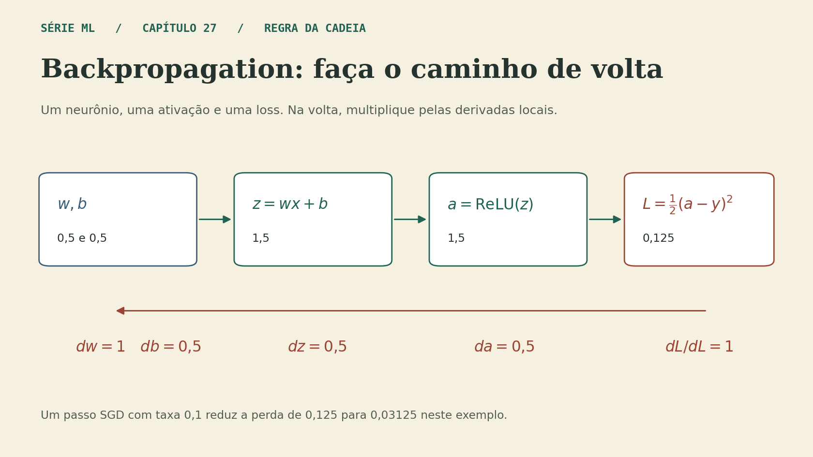
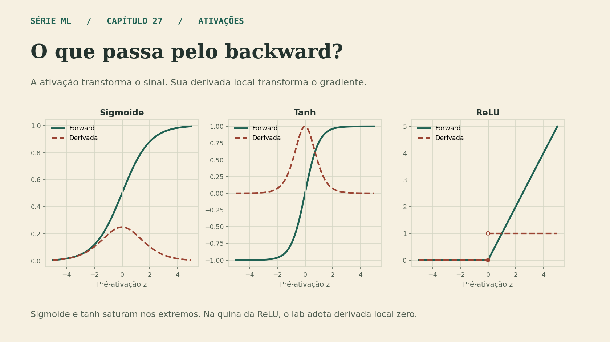
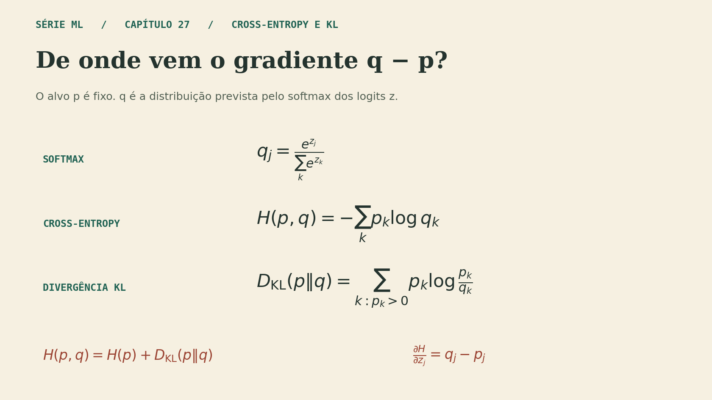
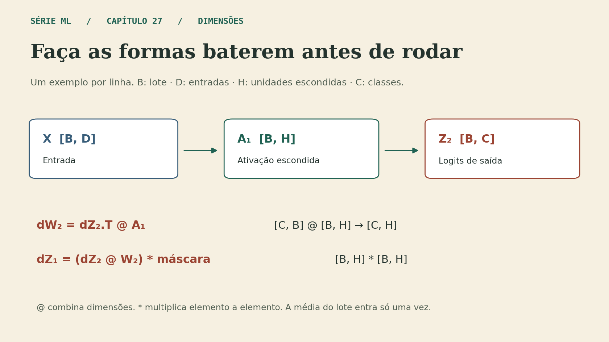
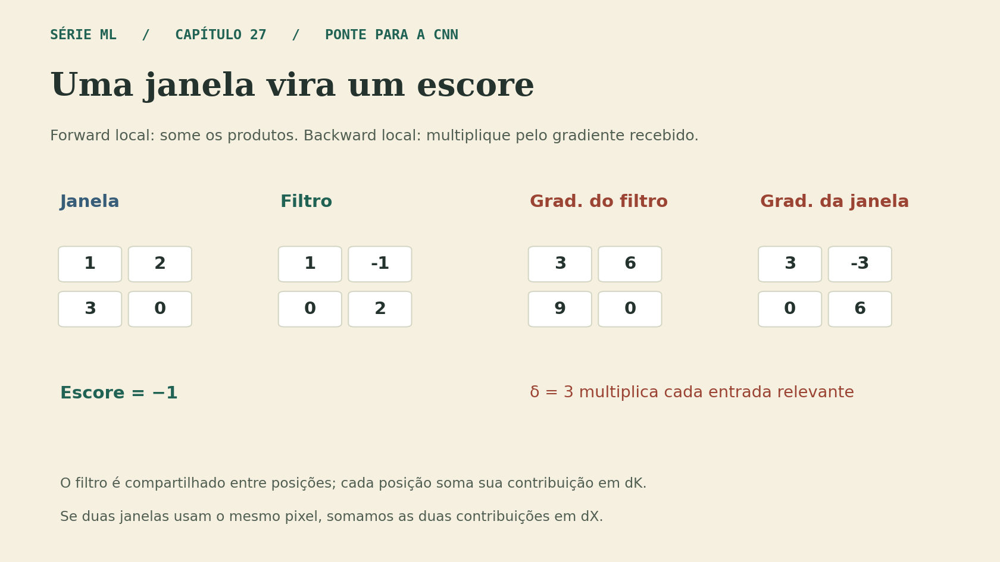

# Do símbolo ao código: a matemática do backpropagation antes da CNN

**Capítulo 27 · Série PyTorch, LLMs e Robótica**

Você roda $\texttt{loss.backward()}$ e aparecem gradientes em todos os pesos. Mas por que aparece uma transposta no cálculo? Por que às vezes o código usa <code>*</code> e às vezes <code>@</code>? E de onde sai o famoso “probabilidade prevista menos rótulo”?

Vamos descobrir em três escalas: **um neurônio na mão**, **um lote de exemplos em NumPy** e **uma conferência com o PyTorch**. No final, abrimos uma janela de convolução para ver por que a CNN usa a mesma matemática, só que soma contribuições de várias posições.

## 1. O que você precisa saber, na ordem certa

1. **Funções e composição.** Se $z=wx+b$ e $a=f(z)$, então mudar um peso muda $z$, o que pode mudar $a$ e, por fim, a loss. Escreva cada operação em uma linha. O programa de trás para frente segue essa composição.
2. **Derivada e derivada parcial.** A derivada é a taxa de variação local da saída. A parcial mexe em uma coordenada, mantendo as outras fixas. O gradiente empilha essas parciais. Na geometria euclidiana usual, o gradiente não nulo aponta para onde a loss cresce mais rápido localmente.
3. **Regras de cálculo.** Constantes derivam para zero. A regra da potência dá $\frac{d}{dx}x^2=2x$. A derivada de uma soma é a soma das derivadas; a de um produto usa $ (uv)'=u'v+uv' $. A exponencial é sua própria derivada e a de $\ln(x)$ é $1/x$ para $x>0$.
4. **Regra da cadeia.** Num caminho, multiplique os fatores locais. Se o valor alimenta mais de um caminho, **some as contribuições** de todos eles. Por exemplo, $x^2+3x$ usa o mesmo $x$ duas vezes: em $x=2$, o gradiente é $4+3=7$, não 12.
5. **Álgebra linear, probabilidades e otimização.** Matrizes fazem com que o mesmo cálculo valha para um lote inteiro. As probabilidades e o log definem o sinal de treino na classificação. Só depois de computar o gradiente o otimizador altera os pesos.

## 2. Regra da cadeia em um único neurônio

Use $x=2$, $w=0{,}5$, $b=0{,}5$ e alvo $y=1$. Faça o forward:

$$
z=wx+b=1{,}5,\quad a=\max(0,z)=1{,}5,\quad
L=\tfrac12(a-y)^2=0{,}125.
$$

A perda quadrática com fator 1/2 é uma escolha didática: o fator 1/2 cancela o 2 da derivada. Não é a convenção da MSE padrão, que usa a média dos quadrados sem esse meio.

No backward, o gradiente que chega à própria loss é $\partial L/\partial L=1$. Andamos na direção contrária:

$$
\frac{\partial L}{\partial a}=a-y=0{,}5,\qquad
\frac{\partial L}{\partial z}=\frac{\partial L}{\partial a}\,\mathrm{ReLU}'(z)=0{,}5.
$$

$$
\frac{\partial L}{\partial w}=0{,}5x=1,\qquad
\frac{\partial L}{\partial b}=0{,}5,\qquad
\frac{\partial L}{\partial x}=0{,}5w=0{,}25.
$$

Com taxa de aprendizado $\eta=0{,}1$, atualize $w$ e $b$ usando os **dois gradientes do mesmo forward**. O peso vai a 0,4, o viés a 0,45, e uma nova passagem dá loss 0,03125.

~~~python
x, w, b, y = 2.0, 0.5, 0.5, 1.0
z = w * x + b
a = max(0.0, z)
loss = 0.5 * (a - y)**2

dz = (a - y) * float(z > 0)
dw, db, dx = dz * x, dz, dz * w
w, b = w - 0.1 * dw, b - 0.1 * db
~~~

**Backpropagation calcula gradientes. SGD usa os gradientes.** São operações diferentes. Uma taxa grande pode passar do ponto e aumentar a loss; uma redução nesse exemplo não garante convergência.

## 3. Ativações: a derivada que multiplica o gradiente

Se as camadas só aplicarem operações afins, empilhar mais camadas ainda dá uma única transformação afim. A ativação não linear é o que quebra essa equivalência.

| Ativação | Valor no forward | Fator local no backward |
| --- | --- | --- |
| Sigmoide | $a=1/(1+e^{-z})$ | $a(1-a)$ |
| Tangente hiperbólica | $a=\tanh(z)$ | $1-a^2$ |
| ReLU | $a=\max(0,z)$ | $1$ se $z>0$, $0$ se $z<0$. Em $z=0$ não há derivada única; usamos zero. |

Quando a sigmoide e a tanh saturam, o fator local fica perto de zero. Multiplicar muitos fatores pequenos é **um** caminho para o gradiente desaparecer; os pesos e o restante da arquitetura também importam. A ReLU não satura no lado positivo, mas zera o gradiente no negativo. Repare que a sigmoide e a tanh usam a **saída** guardada no forward; a máscara de ReLU usa o sinal da **pré-ativação** $z$.

## 4. Cross-entropy e KL: o que estamos comparando?

**Logits** são os escores crus da rede. Para classes mutuamente exclusivas, o softmax os transforma em uma distribuição $q$. O alvo $p$ pode ser one-hot, como $[1,0]$, ou uma distribuição suave do professor, como vimos no capítulo de destilação.

$$
q_j=\frac{e^{z_j}}{\sum_k e^{z_k}},\qquad
H(p,q)=-\sum_k p_k\ln q_k,\qquad
D_{\mathrm{KL}}(p\Vert q)=\sum_{k:p_k>0}p_k\ln\left(\frac{p_k}{q_k}\right).
$$

- **Cross-entropy:** com alvo one-hot, fica só o negativo do log da probabilidade da classe correta. Se a classe certa recebe 80%, a loss é 0,223; se recebe 20%, é 1,609. “Chutar com confiança a classe errada” sai caro.
- **KL:** mede a discrepância direcionada entre distribuições. Trocar $p$ e $q$ muda a pergunta e em geral muda o valor. Por exemplo, para $p=(0{,}9,0{,}1)$ e $q=(0{,}5,0{,}5)$, as duas direções dão aproximadamente 0,368 e 0,511 nats. Quando $p_k=0$, a contribuição desse termo é zero por limite. Se $p_k>0$ e $q_k=0$, a divergência é infinita.
- **Ponte entre elas:** $H(p,q)=H(p)+D_{\mathrm{KL}}(p\Vert q)$. Se o alvo $p$ é fixo, $H(p)$ é constante em relação aos logits do aluno. **A loss numérica pode mudar, mas o gradiente é o mesmo**. Isso não permite trocar o KL de direção nem usar vetores arbitrários como distribuições.
- **MSE:** compara números em uma escala, por exemplo a posição esperada e a prevista. Para regressão, é um ponto de partida; não é a loss usada neste laboratório multiclasse. Classificação multirrótulo é outro caso: logits independentes e, com frequência, BCE com logits em vez de softmax.

### Por que aparece q − p?

Como $\ln q_k=z_k-\ln\sum_j e^{z_j}$ e $\sum_k p_k=1$, a cross-entropy vira:

$$
H(p,q)=\ln\left(\sum_j e^{z_j}\right)-\sum_k p_k z_k.
$$

A parcial do primeiro termo em $z_j$ é $q_j$. A do segundo é $-p_j$. Portanto, por exemplo, se $q=[0{,}8,0{,}2]$ e $p=[0,1]$, sai $q-p=[0{,}8,-0{,}8]$: a descida tende a baixar o logit errado e subir o correto. **Isso vale para softmax com cross-entropy nesse cenário**, não para qualquer combinação de saída e loss. Com a média de um lote de tamanho B, divide-se por B **uma vez só**.

~~~python
# log_softmax estável: não expoencie os logits crus.
shifted = logits - logits.max(axis=1, keepdims=True)
log_q = shifted - np.log(np.exp(shifted).sum(axis=1, keepdims=True))
q = np.exp(log_q)
loss = -(p * log_q).sum(axis=1).mean()
dZ = (q - p) / logits.shape[0]
~~~

No PyTorch, <code>F.cross_entropy(logits, alvo)</code> recebe **logits crus**. O alvo pode ser índices inteiros de classe ou distribuições de mesma forma dos logits. Não passe softmax antes de chamar essa loss. Para usar KL na direção alvo → aluno: <code>F.kl_div(F.log_softmax(logits, dim=-1), p, reduction="batchmean")</code>. O primeiro argumento tem **log** das probabilidades do modelo; usar a redução padrão <code>mean</code> também divide pelo número de classes no caso [B,C]. [CrossEntropyLoss](https://docs.pytorch.org/docs/2.9/generated/torch.nn.CrossEntropyLoss.html) · [KLDivLoss](https://docs.pytorch.org/docs/2.9/generated/torch.nn.KLDivLoss.html).

## 5. Dicionário: os símbolos viram linhas de código

Convenção deste laboratório: **um exemplo por linha**. Para uma camada de entrada D e saída H, a entrada tem forma [B,D], o peso [H,D] e o viés [H]. Assim, <code>X @ W.T + b</code> dá [B,H], a mesma convenção de pesos de [<code>torch.nn.Linear</code>](https://docs.pytorch.org/docs/2.9/generated/torch.nn.Linear.html). Com exemplos em colunas, as fórmulas e eixos mudam; não misture as duas convenções.

| Matemática | NumPy | No laboratório |
| --- | --- | --- |
| Vetor / matriz | <code>np.array(...)</code> | Pesos, entradas e vieses |
| Produto escalar de dois vetores | <code>u @ v</code> | Gera um número |
| Produto matricial | <code>A @ B</code> | Dimensões internas devem coincidir |
| Transposta de uma matriz | <code>W.T</code> | Troca linhas e colunas |
| Hadamard, elemento a elemento | <code>A * B</code> | Aplica a máscara/derivada local |
| Somatório e média | <code>sum(axis=...)</code> e <code>mean(axis=...)</code> | Selecionam qual eixo reduzir |
| Exponencial, log natural | <code>np.exp</code>, <code>np.log</code> | Softmax, entropia e KL |
| Gradiente do peso e do viés | <code>dW</code>, <code>db</code> | Mesma forma de W e b |
| Passo de descida | <code>W -= lr * dW</code> | Depois de terminar o backward |

[Semântica de <code>@</code> e broadcasting no NumPy](https://numpy.org/doc/stable/reference/generated/numpy.matmul.html). Em NumPy não há um operador que derive essa rede automaticamente. A matemática vira funções escritas por nós. O PyTorch, por sua vez, tem um sistema de diferenciação automática próprio. Ele não depende de NumPy para calcular o backward.

## 6. Backward de duas camadas densas, com formas em cada linha

Temos B exemplos, D entradas, H unidades escondidas e C classes. Selecione ReLU para começar, mantenha os pesos originais enquanto o backward calcula todos os gradientes e só atualize no final.

~~~python
# Forward. W1: [H,D], W2: [C,H]; b1: [H], b2: [C].
Z1 = X @ W1.T + b1          # [B,H]
A1 = np.maximum(Z1, 0.)     # [B,H]
Z2 = A1 @ W2.T + b2         # [B,C]

# Backward. A loss retorna o gradiente já dividido pelo batch.
loss, dZ2 = loss_and_dlogits(Z2, P, "ce")
dW2 = dZ2.T @ A1            # [C,B] @ [B,H] → [C,H]
db2 = dZ2.sum(axis=0)       # [C], soma as contribuições de B exemplos
dA1 = dZ2 @ W2              # [B,C] @ [C,H] → [B,H]
dZ1 = dA1 * (Z1 > 0)        # [B,H], multiplicação elemento a elemento
dW1 = dZ1.T @ X             # [H,B] @ [B,D] → [H,D]
db1 = dZ1.sum(axis=0)       # [H]
dX = dZ1 @ W1               # [B,D], pode seguir para uma camada anterior
~~~

Por que $\mathrm{d}W=\mathrm{d}Z^\mathsf T X$? Para o peso da saída h e entrada d, cada exemplo contribui $\mathrm{d}Z_{nh}X_{nd}$. O produto matricial soma isso em n. O mesmo viés é usado em todos os exemplos, então suas contribuições também são somadas. Como a média já entrou em <code>dZ2</code>, não volte a dividir em <code>dW</code> ou <code>db</code>.

### A Jacobiana explica por que o código é pequeno

Para uma função vetorial $y=f(x)$, a Jacobiana guarda uma derivada por par saída/entrada: $J_{ij}=\partial y_i/\partial x_j$. Usando gradientes como vetores-coluna, a propagação de um gradiente recebido $g_y$ é $g_x=J^\mathsf T g_y$. Essa multiplicação, chamada **produto vetor–Jacobiana** quando escrita como $g_y^\mathsf T J$, é a operação central do modo reverso.

Em uma ativação por elemento, J é diagonal: em vez de alocar J, multiplique os fatores com <code>*</code>. Já o softmax mistura classes: aumentar um logit muda outras probabilidades. A Jacobiana completa não é diagonal. Ao combinar softmax e cross-entropy, a álgebra permite calcular **direto** o produto necessário, que vira <code>q - p</code>. O autograd também compõe regras locais sem precisar construir a Jacobiana gigante do modelo. [Baydin et al., diferenciação automática](https://jmlr.org/papers/v18/17-468.html) · [Mecânica do autograd no PyTorch](https://docs.pytorch.org/docs/2.9/notes/autograd.html).

## 7. Conferência do laboratório: NumPy, diferença finita e PyTorch

O pacote usa **três exemplos fixos**, duas camadas densas e CPU em float64. Verificamos todos os elementos de W1, b1, W2, b2 e X. A diferença central perturba um elemento por vez:

$$
\frac{\partial L}{\partial w}\approx\frac{L(w+\epsilon)-L(w-\epsilon)}{2\epsilon}.
$$

É um teste, não uma forma prática de treinar redes grandes. Não use um ponto de quina da ReLU para exigir que a diferença finita bata com a convenção escolhida pelo autograd. Um é uma aproximação simétrica; o outro usa uma derivada local definida pela implementação.

| Cenário | Loss antes → depois de um passo SGD | Maior diferença com autograd |
| --- | --- | --- |
| ReLU + cross-entropy, rótulos one-hot | 1,436858 → 1,300514 | 1,11 × 10⁻¹⁶ |
| Tanh + cross-entropy, alvos suaves | 1,215237 → 1,186591 | 2,78 × 10⁻¹⁷ |
| Sigmoide + KL, alvos suaves | 0,415087 → 0,410830 | 4,16 × 10⁻¹⁷ |

O pior erro contra diferenças finitas foi **1,70 × 10⁻¹⁰**, com epsilon 10⁻⁶. As diferenças próximas à precisão de máquina são deste caso controlado, não uma tolerância universal. Os seis testes também verificam logits extremos, invariância ao duplicar o lote, a identidade entre CE e KL e a convenção da ReLU em zero. **Não compare os valores de CE e KL entre linhas para escolher uma ativação:** o objetivo e os alvos também mudam.

~~~bash
python -m pip install -r requirements.txt
python lab.py
python -m unittest -v test_lab.py
~~~

Sem instalar PyTorch, <code>python lab.py --numpy-only</code> ainda executa o cálculo manual e o teste numérico; para comparar com o autograd, use o ambiente completo. [Repositório da série](https://github.com/vanedaltro/ml_rl_robotics).

## 8. A ponte para a CNN: por que os gradientes precisam ser somados?

Abra uma janela 2×2 da imagem e um filtro 2×2. Para obter um número na saída, multiplique cada pixel pelo peso da mesma posição e some. O [<code>Conv2d</code> do PyTorch](https://docs.pytorch.org/docs/2.9/generated/torch.nn.Conv2d.html) faz **correlação cruzada** no forward, sem virar o filtro. É um produto escalar local; não é a multiplicação matricial <code>patch @ kernel</code> entre duas matrizes 2×2.

Se a derivada recebida naquela posição é $\delta$, a regra da cadeia dá **delta vezes a janela** para o gradiente do filtro e **delta vezes o filtro** para o gradiente da janela. Um viés compartilhado recebe $\delta$. O mesmo filtro reaparece em várias posições da imagem: **some** as contribuições dos pesos. Um mesmo pixel pode cair em várias janelas: **some** suas contribuições também.

Exercício para o próximo capítulo: use janela <code>[[1, 2], [3, 0]]</code>, filtro <code>[[1, -1], [0, 2]]</code>, viés zero e gradiente recebido 3. O forward dá **−1**; as contribuições para o filtro são <code>[[3, 6], [9, 0]]</code>, e para os pixels, <code>[[3, -3], [0, 6]]</code>. Agora faça duas janelas se sobreporem. Onde você precisaria usar <code>+=</code> em vez de <code>=</code>?

No próximo laboratório, a gente faz esse acúmulo para a imagem inteira e compara o backward da CNN com o autograd.
