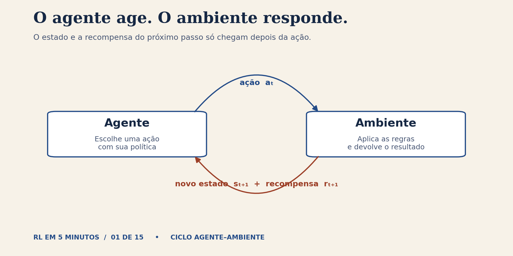
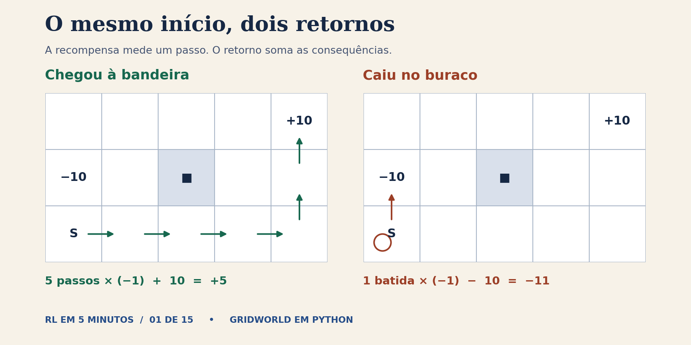

Imagine um robô num tabuleiro. Ele pode avançar, bater na parede ou cair num buraco. Ninguém entrega uma tabela com a ação certa para cada casa. O ambiente só informa o que aconteceu e quantos pontos aquela decisão rendeu. É dessa interação que o aprendizado por reforço, ou **Reinforcement Learning (RL)**, tira seu sinal de aprendizado.

## Assista ao episódio 1 · 5 minutos

O vídeo original de cinco minutos acompanha o artigo da série. O MP4 não faz parte deste repositório.

## Na prática: a decisão muda o que o agente verá depois

No aprendizado supervisionado, poderíamos treinar com pares como **(casa do tabuleiro, seta correta)**. Em RL, a interação gera outro dado: **(estado, ação, recompensa, novo estado)**. A escolha de agora também muda as situações que o agente poderá encontrar depois. Se ele cair no buraco, não tem como continuar até a bandeira naquele episódio.



- **Estado $s_t$:** onde o robô está. Aqui, basta a dupla `(linha, coluna)` porque o tabuleiro e as regras são fixos. Uma câmera real pode revelar só parte do estado.
- **Ação $a_t$:** cima, direita, baixo ou esquerda. Tentar sair do grid ou atravessar a parede custa 1 ponto e não muda a posição.
- **Recompensa $r_{t+1}$:** o número que o ambiente devolve após a ação. No laboratório, o passo comum vale −1, a bandeira vale +10 e o buraco vale −10. Os valores terminais **substituem** o −1 naquele passo.
- **Política $\pi(a\mid s)$:** regra de escolha da próxima ação. Pode ser determinística ou atribuir probabilidades. O ambiente executa a ação; a política decide qual ação tentar.
- **Episódio:** uma interação completa do início ao término. Bandeira e buraco encerram este exemplo; uma sequência manual que para no meio é só uma trajetória parcial.

## Recompensa não é retorno

Um passo de −1 pode ser uma boa decisão se aproximar o robô da bandeira. O que importa para avaliar a sequência é o **retorno**, a soma das recompensas futuras. O desconto $\gamma$ reduz o peso das recompensas mais distantes; aqui, usamos $\gamma=1$ para reproduzir a soma simples do episódio.

$$G_0=\sum_{t=0}^{T-1}\gamma^t r_{t+1}$$



## Do diagrama ao código

A função `step` aplica as regras. Ela não escolhe a ação e não melhora por conta própria. Para começar, passamos duas sequências fixas ao simulador e conferimos as contas. São trajetórias escolhidas para ensinar, **não resultados de um agente treinado**.

```python
from grid import episodio, retorno

sucesso = episodio("DDDDCC")  # direita 4 vezes, cima 2 vezes
falha = episodio("EC")       # esquerda bate na borda, cima cai no buraco

print(retorno(sucesso))      #  5.0
print(retorno(falha))        # -11.0
print(retorno(sucesso, .9))  #  1.8098
```

Para calcular o retorno, o código percorre a trajetória de trás para frente. A cada passo soma a recompensa atual ao futuro descontado: `g = recompensa + gamma * g`. Repare que trocar $\gamma$ não altera o −1 ou o +10 registrados no episódio; muda apenas como calculamos o retorno.

Para rodar o laboratório completo, entre na pasta do capítulo e execute:

```bash
python3 grid.py
```

As oito verificações cobrem movimento, parede, término do episódio, retornos conhecidos e desconto. Não há dependência externa. A curva de treino mostrada no vídeo é ilustrativa; os três retornos acima vieram do script.

## Como saber se uma política melhorou?

Não escolha o melhor episódio isolado. Compare o **retorno médio** em episódios de avaliação e acompanhe também quantas vezes chegou à bandeira, quantas caiu e quantos passos levou. Neste grid fixo a execução de uma sequência fixa é determinística. Quando adicionarmos aleatoriedade, teremos de comparar políticas com o mesmo protocolo e repetir com várias sementes.

**Experimento:** adicione mais uma tentativa inútil de ir para a esquerda antes da rota que funciona. A posição não muda, mas o retorno sem desconto cai de +5 para +4. Isso mostra que a recompensa especifica o comportamento desejado: se cada passo fosse grátis, o agente não teria o mesmo incentivo para chegar mais rápido.

No próximo episódio, vamos isolar uma decisão que todo agente enfrenta: **repetir a ação que já parece boa ou testar outra que pode ser melhor?** Começamos com *bandits*, onde a ação não leva a um novo estado relevante.

**Para aprofundar:** [Sutton e Barto, *Reinforcement Learning: An Introduction*](https://mitpress.mit.edu/9780262039246/reinforcement-learning/) e [GridWorld na documentação do Gymnasium](https://gymnasium.farama.org/tutorials/gymnasium_basics/environment_creation/). O miniambiente aqui usa uma interface didática, sem se apresentar como implementação da API Gymnasium.
