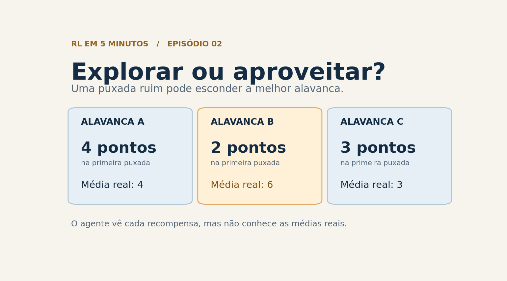
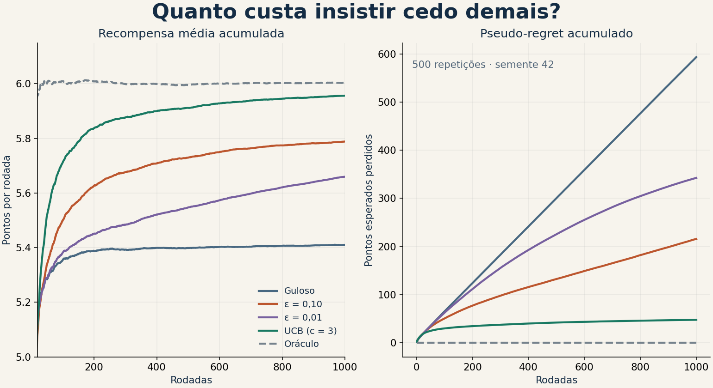

# Explorar ou aproveitar? Três alavancas e uma primeira impressão ruim

No primeiro episódio, o robô recebeu recompensas por andar num tabuleiro. Agora ele fica parado diante de três alavancas. Cada uma dá pontos, mas ele não sabe qual vale mais. Só pode puxar uma por rodada. Como aprender sem gastar todas as rodadas testando?



Assista ao vídeo de cinco minutos antes de rodar o laboratório. A curva animada do vídeo é ilustrativa. Os gráficos mais abaixo foram gerados pelo programa com 500 repetições.

## 1. Por que a melhor alavanca pode parecer pior?

Cada puxada de A rende 3, 4 ou 5 pontos; B rende 2, 5, 7 ou 10; C rende 1, 3 ou 5. Os resultados de cada alavanca são equiprováveis, então as médias reais são 4, 6 e 3. Esse é o nosso laboratório: ele usa uma distribuição discreta, não a curva em sino que aparece no vídeo.

Imagine que a primeira puxada de cada alavanca dê A = 4, B = 2, C = 3. O agente guloso sempre escolhe a maior média observada. Escolhe A e, neste cenário, pode nem voltar a B: A sempre paga pelo menos 3, enquanto a estimativa de B continua em 2. Se testar B novamente e tirar 7, a estimativa vira 4,5. Uma única puxada ruim escondeu a melhor escolha.

Chamamos isso de *multi-armed bandit*. Neste exemplo, não há contexto que mude de uma rodada para outra, e puxar uma alavanca não muda as próximas opções. No próximo capítulo, a ação também poderá mudar o estado do robô. Aí o problema vira um MDP.

## 2. Como guardar uma média sem guardar todas as puxadas?

A atualização é **estimativa antiga + passo × erro de previsão**. Quando o número de puxadas N(a) já inclui a atual:

$$Q(a) \leftarrow Q(a) + \frac{r-Q(a)}{N(a)}.$$

Em Python, a mesma conta fica assim:

```python
n[a] += 1
q[a] += (reward - q[a]) / n[a]
```

Para B, se Q = 2 e a segunda recompensa for 7, obtemos 2 + (7 − 2)/2 = 4,5. Aqui Q é só a média da recompensa imediata da alavanca. Mais adiante, Q também vai representar o valor das consequências futuras de agir em certo estado.

## 3. Duas maneiras de dar uma nova chance à alavanca B

**ε-greedy.** Com probabilidade ε, escolha uma alavanca ao acaso, incluindo a que parece melhor. Caso contrário, use a melhor estimativa atual. Com ε = 0,10 e três alavancas, se houver uma única líder, o agente escolhe uma das outras duas em 6,67% das rodadas após a inicialização, não em 10%.

```python
if rng.random() < epsilon:
    a = rng.randrange(len(q))
else:
    maximum = max(q)
    a = rng.choice([i for i, value in enumerate(q) if value == maximum])
```

**UCB.** Em vez de sortear quando explorar, some à média um bônus para opções ainda pouco testadas:

$$a_t = \operatorname*{argmax}_a \left[Q(a) + c\sqrt{\frac{\ln t}{N(a)}}\right].$$

```python
from math import log, sqrt

scores = [v + 3.0 * sqrt(log(t) / count) for v, count in zip(q, n)]
```

Primeiro, teste cada alavanca uma vez para não dividir por zero. Para uma rodada fixa, quanto maior N(a), menor o bônus. O c = 3 do laboratório é um coeficiente ilustrativo na escala dos pontos; não é o mesmo que executar o UCB1 clássico com recompensas normalizadas a [0, 1]. O bônus é uma regra de escolha, não uma garantia de que a média real esteja dentro de um intervalo em cada rodada.

## 4. O que aconteceu quando rodamos?

Foram 500 repetições de 1.000 rodadas, semente 42. Todas as estratégias que aprendem começam testando A, B e C uma vez, na mesma ordem. O oráculo já conhece a melhor média e sempre escolhe B. Dentro de cada repetição, a k-ésima puxada de uma alavanca tem a mesma amostra para todas as estratégias.

| Estratégia | Pontos por rodada | Pseudo-regret acumulado | % de puxadas em B |
|---|---:|---:|---:|
| Guloso | 5,41 | 593,69 | 70,64% |
| ε = 0,01 | 5,66 | 342,62 | 83,23% |
| ε = 0,10 | 5,79 | 215,66 | 90,97% |
| UCB, c = 3 | 5,96 | 47,54 | 97,96% |
| Oráculo | 6,00 | 0,00 | 100,00% |



O pseudo-regret mede os pontos esperados que deixamos na mesa. Neste experimento, cada puxada de A custa 6 − 4 = 2, uma de C custa 6 − 3 = 3 e uma de B custa zero. Ele usa as médias verdadeiras, disponíveis ao avaliador da simulação, não ao agente. Por isso, o oráculo pode obter um pouco mais ou menos que 6 pontos por rodada na amostra e ainda ter pseudo-regret zero.

O UCB foi melhor **neste** ambiente, com este horizonte e este coeficiente. Aqui ε = 0,10 terminou melhor do que ε = 0,01; o vídeo mostra uma curva com outro comportamento para ilustrar o dilema. Um ε pequeno pode descobrir B devagar; um ε fixo grande continua sorteando mesmo depois de aprender. Experimente trocar o horizonte ou diminuir a distância entre as médias e compare as curvas de novo.

## 5. Rode o laboratório

[Abra o código, os testes e os gráficos no GitHub](https://github.com/vanedaltro/ml_rl_robotics/tree/main/rl-em-5-minutos/02-bandits). O simulador usa só a biblioteca padrão do Python.

```bash
cd rl-em-5-minutos/02-bandits
python3 -m unittest -v
python3 bandits.py --rodadas 1000 --repeticoes 500 --seed 42
```

Um exemplo fora dos jogos: escolher qual versão de uma página mostrar quando seu objetivo é aprender qual tem mais cliques sem desperdiçar todo o tráfego. Se o perfil do visitante muda a melhor escolha, você já tem contexto a considerar. Se a escolha muda o que será possível fazer depois, já precisa representar transições entre estados.

**Próximo episódio:** processos de decisão de Markov. O robô sai de frente das alavancas e volta a tomar decisões que mudam onde ele está.

Leituras: [Sutton e Barto, *Reinforcement Learning: An Introduction*, cap. 2](http://incompleteideas.net/book/the-book-2nd.html) · [Auer, Cesa-Bianchi e Fischer, análise de UCB1](https://doi.org/10.1023/A:1013689704352).
